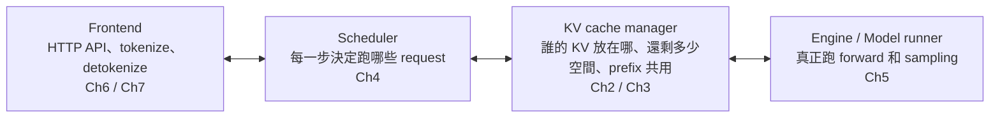
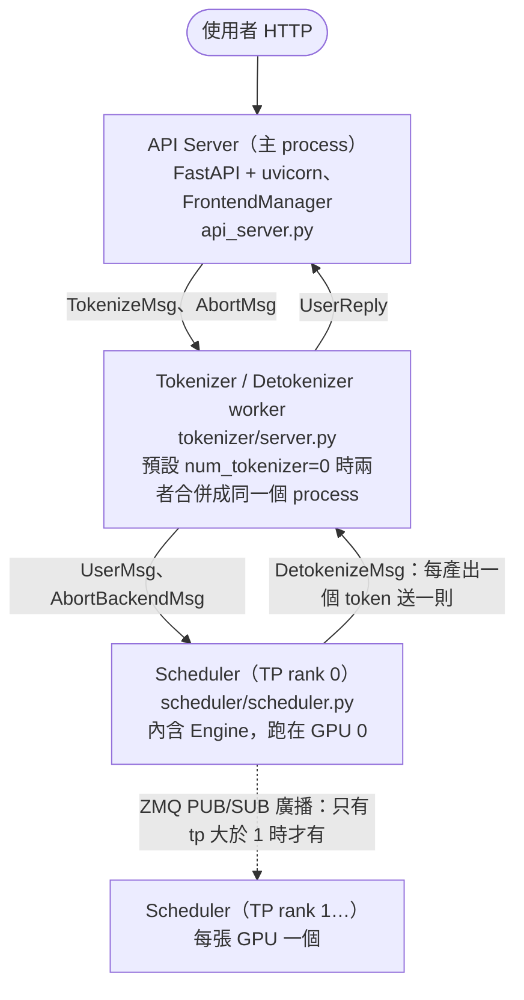
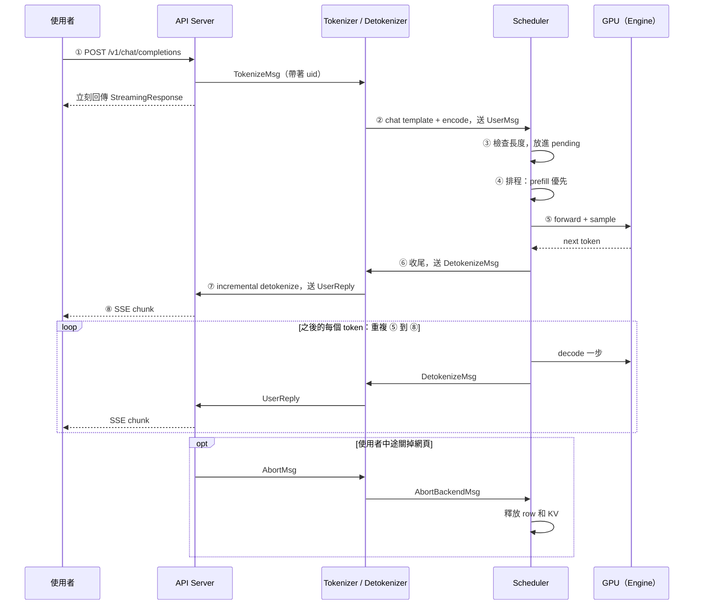

# Ch1 — LLM Serving 全景與一個 request 的旅程

> **用法**：大約 60 到 75 分鐘。前半段（§1–§3）講**概念**，不需要看程式碼；後半段（§4–§7）**對照 mini-sglang 原始碼**，跟著一個 request 從進來到離開，完整走一遍。§5 最好把連結點開，一站一站對照著讀。
> 讀完做最下面的考題。
> 程式碼連結都指向 upstream `9a91cfa`，本地路徑是 `~/Desktop/repos/mini-sglang/python/minisgl/`。

Ch0 的結論是：**decode 受限於記憶體頻寬，把很多 request 湊在一起算，吞吐量幾乎可以免費翻倍。** 這一章要回答的是：真的要同時服務很多人時，系統該怎麼設計？

---

## 1. Serving 要解決什麼問題

只服務一個人很簡單：`model.generate(prompt)` 跑完就結束。但線上服務的情況是：
- request **隨時**進來，不會排好隊一起到
- 每個 request 的 prompt 長度都不一樣，從 10 個 token 到 10 萬個 token 都有
- 每個 request 要生成的長度**事先不知道**，什麼時候遇到 EOS 只有模型自己知道
- 使用者希望文字**一個字一個字串流出來**，而且隨時可能關掉網頁

### 三種做法的演進

假設有 A、B、C 三個 request，分別要生成 3、8、2 個 token。下圖中每一格是一次 forward：

**做法一：一次只服務一個人**
```
GPU: A A A B B B B B B B B C C
```
Ch0 已經算過，decode 一次只算 1 個 token，GPU 幾乎都在空等記憶體。**吞吐量極差**。

**做法二：Static batching（傳統深度學習的做法）**
```
GPU: [ABC][ABC][ABC][ B ][ B ][ B ][ B ][ B ]   ← 整批要等最慢的 B 跑完才結束
         A、C 早就生完了，它們的位置只能空轉（浪費），新的 request D 也只能在門外等
```
問題有兩個：
- 短的 request 被長的拖累，佔著位置空轉
- 新來的 request 要等**整批**結束才能進場，等待時間不可控

**做法三：Continuous batching（iteration-level scheduling）**
```
iter:  1    2    3    4    5    6    7    8
GPU: [ABC][ABC][AB D][B D][B D][B DE][B E][B E]
             C 生完立刻離開  D 立刻遞補  A 離開  E 進場 …
```
**每一次 iteration（每一次 forward）都重新決定這一步要讓誰上場**：
- 生完的 request 立刻離場，空出位置
- 新來的 request 隨時可以插隊加入

這個做法出自 2022 年的 Orca 論文，**是所有現代 serving 引擎的基礎**，包括 vLLM、SGLang、TensorRT-LLM，以及 mini-sglang。

> mini-sglang 的整個 scheduler，本質上就是一個 `while True:` 迴圈，每一圈決定「這一步跑哪個 batch」（[`scheduler.py:121-131`](https://github.com/sgl-project/mini-sglang/blob/9a91cfa/python/minisgl/scheduler/scheduler.py#L121-L131)）。

---

## 2. 評估 serving 系統的指標

| 指標 | 意思 | 使用者感受 | 主要受哪個階段影響 |
|---|---|---|---|
| **TTFT**（time to first token） | 從送出 request 到看到第 1 個字 | 「它有沒有在回應我？」 | prefill，加上**排隊時間** |
| **TPOT / ITL**（time per output token / inter-token latency） | 之後每個字之間的間隔 | 「字跑得順不順？」 | decode |
| **E2E latency** | 整個回答完成的時間 ≈ TTFT + TPOT × (輸出長度 − 1) | 「多久回完？」 | 兩者都有 |
| **Throughput** | 每秒總共產出多少 token（或完成多少 request） | 老闆關心的：一張卡能服務多少人 | batch 大小 |

實務上通常會再看 **P50、P99**。P99 指的是最慢的那 1% 的使用者等了多久。mini-rsglang 的 FINDINGS 中，Rust 前端輸給 Python 前端的就是 **P99 TTFT**（這是 Ch7 的主題）。

### 核心取捨

- **batch 越大，throughput 越高**，但每一步要讀的 KV 越多（Ch0 F4），所以 **TPOT 會變慢**
- **新 request 一進來就馬上 prefill**，對它的 TTFT 有利；但那一步 GPU 都在做 prefill，**正在 decode 的其他人就要等**，他們的 TPOT 會出現一次尖峰
- 所以**沒有完美的排程，只有取捨**。scheduler 的策略決定了你偏向哪一邊。Ch4 會看到 mini-sglang 選擇「prefill 優先」，再用 chunked prefill 來緩和尖峰

---

## 3. 一個 serving 引擎的四大元件

不管是 vLLM、SGLang 還是 mini-sglang，拆開來都是這四塊：



對照 [`CONTEXT.md`](../../CONTEXT.md) 的術語：最左邊的 **Frontend** 是 mini-rsglang 用 Rust 改寫的部分；右邊三塊合起來就是 **Backend**，在 mini-rsglang 中仍然是原封不動的 upstream Python。

---

## 4. mini-sglang 的 process 架構

### 4.1 有哪些 process



**預設設定**（`--tp 1`、`num_tokenizer=0`）下只有 **3 個 process**：API server、tokenizer/detokenizer、scheduler。
- `num_tokenizer` 的預設值是 0（[`server/args.py:18`](https://github.com/sgl-project/mini-sglang/blob/9a91cfa/python/minisgl/server/args.py#L18)），這時 `share_tokenizer` 為 True，tokenizer 和 detokenizer 共用同一個 process 和同一個收件地址（[`args.py:22-36`](https://github.com/sgl-project/mini-sglang/blob/9a91cfa/python/minisgl/server/args.py#L22-L36)）
- 同一個 worker 函式靠**訊息型別**判斷要做哪件事（[`tokenizer/server.py:67-69`](https://github.com/sgl-project/mini-sglang/blob/9a91cfa/python/minisgl/tokenizer/server.py#L67-L69)）

### 4.2 為什麼要拆成好幾個 process，而不是開 thread？

**Python 的 GIL（Global Interpreter Lock）**：同一個 process 裡，同一時間只有一個 thread 能執行 Python 程式碼。

如果 HTTP 處理、tokenize、detokenize 跟 scheduler 擠在同一個 process：
- 處理一個長 prompt 的 tokenize，或幾百個 SSE 串流，都會**佔住 CPU**
- scheduler 準備下一個 batch 的動作因此被延後
- **GPU 就只能空等**，這是 serving 系統最忌諱的事

拆成獨立的 process，每個 process 都有自己的 GIL，scheduler 就能專心讓 GPU 保持忙碌。

代價是：process 之間不能直接共享 Python 物件，所有溝通都必須**序列化成 bytes 再傳送**。這一層就是 mini-rsglang 所說的 **wire contract**。

### 4.3 Process 之間怎麼溝通：ZMQ + msgpack

- **ZeroMQ（ZMQ）**：一個訊息佇列函式庫。mini-sglang 使用它的 **PUSH/PULL** 模式，一端 push、另一端 pull，是單向的管道
- **`ipc://`**：傳輸走本機的 Unix domain socket，不經過網路
- **msgpack**：把 dataclass 序列化成 bytes 的格式，類似 JSON，但更小、更快（Ch6 會詳細說明）

四個地址（[`scheduler/config.py:24-33`](https://github.com/sgl-project/mini-sglang/blob/9a91cfa/python/minisgl/scheduler/config.py#L24-L33)、[`server/args.py:26-36`](https://github.com/sgl-project/mini-sglang/blob/9a91cfa/python/minisgl/server/args.py#L26-L36)）：

| 地址 | 誰在收（PULL） | 誰在送（PUSH） | 傳什麼 |
|---|---|---|---|
| `ipc:///tmp/minisgl_0…` | Scheduler rank 0 | Tokenizer | `UserMsg`、`AbortBackendMsg` |
| `ipc:///tmp/minisgl_1…` | Detokenizer（共用模式下也兼 tokenizer） | Scheduler、API server | `DetokenizeMsg`、`TokenizeMsg`、`AbortMsg` |
| `ipc:///tmp/minisgl_2…` | Scheduler rank 1… | Scheduler rank 0（PUB/SUB） | 轉發的 backend 訊息 |
| `ipc:///tmp/minisgl_3…` | API server | Detokenizer | `UserReply` |

訊息型別定義在 [`message/`](https://github.com/sgl-project/mini-sglang/blob/9a91cfa/python/minisgl/message/)，每一種都只是一個小 dataclass，例如 [`message/tokenizer.py:27-43`](https://github.com/sgl-project/mini-sglang/blob/9a91cfa/python/minisgl/message/tokenizer.py#L27-L43)。

### 4.4 啟動順序

[`server/launch.py:40-113`](https://github.com/sgl-project/mini-sglang/blob/9a91cfa/python/minisgl/server/launch.py#L40-L113)：

1. 主 process 解析參數，建立 `FrontendManager` 和它的兩個 ZMQ socket（[`api_server.py:430-443`](https://github.com/sgl-project/mini-sglang/blob/9a91cfa/python/minisgl/server/api_server.py#L430-L443)）
2. `start_backend()` 用 `mp.Process` **spawn** 出：
   - 每個 TP rank 一個 scheduler（[`launch.py:59-69`](https://github.com/sgl-project/mini-sglang/blob/9a91cfa/python/minisgl/server/launch.py#L59-L69)）
   - 1 個 detokenizer（[`:73-87`](https://github.com/sgl-project/mini-sglang/blob/9a91cfa/python/minisgl/server/launch.py#L73-L87)）
   - 若干個 tokenizer（[`:88-103`](https://github.com/sgl-project/mini-sglang/blob/9a91cfa/python/minisgl/server/launch.py#L88-L103)）
3. 每個 scheduler 在建構 `Engine` 時會做以下幾件事（[`engine/engine.py:30-110`](https://github.com/sgl-project/mini-sglang/blob/9a91cfa/python/minisgl/engine/engine.py#L30-L110)）：
   - 記下載入前的剩餘顯存
   - **載入權重**
   - 依照**剩下的顯存**決定 KV cache 能放多少 token（[`_determine_num_pages`, `:148-168`](https://github.com/sgl-project/mini-sglang/blob/9a91cfa/python/minisgl/engine/engine.py#L148-L168)）。看看 `cache_per_page` 的算式，**跟 Ch0 §7 的公式一模一樣**
   - 配置 KV pool 和 page table
   - 錄製 CUDA graph（Ch5）
4. 主 process 等待所有子 process 回報「我準備好了」（[`:110-111`](https://github.com/sgl-project/mini-sglang/blob/9a91cfa/python/minisgl/server/launch.py#L110-L111)）
5. 執行 `uvicorn.run(...)`，開始接受 HTTP 連線（[`api_server.py:450`](https://github.com/sgl-project/mini-sglang/blob/9a91cfa/python/minisgl/server/api_server.py#L450)）

> **💡 對 Ch0 §7 的實際印證**：`memory_ratio` 預設是 0.9。在 RTX 3050（8 GB）上載入 Qwen3-0.6B 後，log 會印出 `Allocating N tokens for KV cache`。週六做實驗時你會看到真實的 N。

---

## 5. 一個 request 的完整旅程（本章核心）

**情境**：使用者送出以下請求：

```json
POST /v1/chat/completions
{"model": "qwen3", "messages": [{"role": "user", "content": "你好"}], "max_tokens": 3, "stream": true}
```

假設套上 chat template 後的 prompt 是 **10 個 token**。

先看全貌，下面再一站一站展開：



### 第 ① 站：API Server 收件

[`api_server.py:255-284`](https://github.com/sgl-project/mini-sglang/blob/9a91cfa/python/minisgl/server/api_server.py#L255-L284)

1. `state.new_user()` 發一個**全域遞增的 `uid`**（[`:109-114`](https://github.com/sgl-project/mini-sglang/blob/9a91cfa/python/minisgl/server/api_server.py#L109-L114)），並為它準備一個收件匣 `ack_map[uid]` 和一個通知用的 `asyncio.Event`
2. 把 `messages` 和 sampling 參數包成 **`TokenizeMsg(uid, text, sampling_params)`**，push 給 tokenizer
3. **立刻**回傳一個 `StreamingResponse`。這時連 tokenize 都還沒做，HTTP 連線就這樣開著，等待資料流進來

> `uid` 是這個 request 在整個系統中的身分證。之後每一個 process、每一則訊息，都靠它認人。

### 第 ② 站：Tokenizer

[`tokenizer/server.py:60-101`](https://github.com/sgl-project/mini-sglang/blob/9a91cfa/python/minisgl/tokenizer/server.py#L60-L101)、[`tokenize.py:14-31`](https://github.com/sgl-project/mini-sglang/blob/9a91cfa/python/minisgl/tokenizer/tokenize.py#L14-L31)

1. `messages` 是 list，所以先套用 **chat template**，加上 `<|im_start|>user …<|im_end|><|im_start|>assistant` 這類特殊標記，再 encode 成 token id
2. 包成 **`UserMsg(uid, input_ids, sampling_params)`**，push 給 scheduler

### 第 ③ 站：Scheduler 收件、登記

[`scheduler.py:169-189`](https://github.com/sgl-project/mini-sglang/blob/9a91cfa/python/minisgl/scheduler/scheduler.py#L169-L189)

1. 檢查長度：prompt 超過 `max_seq_len` 時**直接丟棄**（只印一行 warning）；`max_tokens` 超出可用空間時會被**往下調整**
   > 記住「直接丟棄」這點。被丟棄的 request，前端永遠等不到回覆，連線會一直掛著。mini-rsglang 為此改成直接回傳 400（Ch7）
2. `prefill_manager.add_one_req(msg)`：放進 **pending 佇列**，等待 prefill

### 第 ④ 站：排程，決定這一步跑誰

[`scheduler.py:219-225`](https://github.com/sgl-project/mini-sglang/blob/9a91cfa/python/minisgl/scheduler/scheduler.py#L219-L225)

```python
batch = (self.prefill_manager.schedule_next_batch(self.prefill_budget)   # 有人等 prefill → 先做 prefill
         or self.decode_manager.schedule_next_batch())                  # 否則做 decode
```

- **prefill 優先**，而且一個 batch **只會是 prefill 或只會是 decode**，不會混在一起
- 選好 batch 之後，`_prepare_batch`（[`:204-217`](https://github.com/sgl-project/mini-sglang/blob/9a91cfa/python/minisgl/scheduler/scheduler.py#L204-L217)）會做以下準備：
  - 為這次要算的 token **分配 KV cache 位置**（`allocate_paged`，Ch2）
  - 算出每個 token 的 `positions`（Ch0 的 RoPE 需要用到）
  - 算出新 K/V 要寫到哪裡（`out_loc`，Ch2）
  - 準備 attention metadata（Ch0 §6 提到的 request 邊界資訊）

### 第 ⑤ 站：GPU 計算

[`scheduler.py:227-233`](https://github.com/sgl-project/mini-sglang/blob/9a91cfa/python/minisgl/scheduler/scheduler.py#L227-L233) → [`engine.py:191-206`](https://github.com/sgl-project/mini-sglang/blob/9a91cfa/python/minisgl/engine/engine.py#L191-L206)

1. 跑 model forward：這次 prefill 有 10 個 token，所以 `num_tokens = 10`
2. **lm_head 只取每個 request 的最後一個 token**（[`layers/embedding.py:92-94`](https://github.com/sgl-project/mini-sglang/blob/9a91cfa/python/minisgl/layers/embedding.py#L92-L94)），因為只有最後一個位置的 logits 能預測「下一個」token
3. **Sampling** 選出下一個 token
4. 這個 token 會：
   - 寫進 GPU 上的 `token_pool`（[`scheduler.py:231`](https://github.com/sgl-project/mini-sglang/blob/9a91cfa/python/minisgl/scheduler/scheduler.py#L231)），讓下一步 decode 可以直接在 GPU 上取用
   - **非同步**複製一份到 CPU（[`engine.py:202-205`](https://github.com/sgl-project/mini-sglang/blob/9a91cfa/python/minisgl/engine/engine.py#L202-L205)）

### 第 ⑥ 站：Scheduler 收尾

[`scheduler.py:138-167`](https://github.com/sgl-project/mini-sglang/blob/9a91cfa/python/minisgl/scheduler/scheduler.py#L138-L167)

1. 把新 token 接到 `req.input_ids` 後面
2. 判斷是否結束：**達到 `max_tokens`**（`not req.can_decode`），或者**生成了 EOS**（除非設定了 `ignore_eos`）
3. 送出 **`DetokenizeMsg(uid, next_token, finished)`**，**一次只帶一個 token id**
4. 如果結束了：從 decode 名單移除，釋放資源，並把它的 KV **交給 prefix cache 保存**（Ch3）
5. 如果還沒結束、而且剛做完 prefill：先把 prompt 的 KV 登記進 prefix cache，讓之後相同開頭的 request 可以共用

### 第 ⑦ 站：Detokenizer

[`tokenizer/detokenize.py:70`](https://github.com/sgl-project/mini-sglang/blob/9a91cfa/python/minisgl/tokenizer/detokenize.py#L70) 起

把 token id 轉回文字。**這比想像中難**：
- 一個中文字可能被切成 2 到 3 個 token（UTF-8 的位元組片段）。只收到前半段時，解碼出來是亂碼，**不能送出**
- 英文單字也可能被切開，所以要等到看見空白才送出（[`find_printable_text`, `:35-51`](https://github.com/sgl-project/mini-sglang/blob/9a91cfa/python/minisgl/tokenizer/detokenize.py#L35-L51)）

因此 detokenizer 會為**每個 uid 各自保存解碼狀態**（`decode_map`），只送出「這次新增、而且確定可以印出來」的那段文字，包成 **`UserReply(uid, incremental_output, finished)`**。

> mini-rsglang 的 `rsg-tokenizer` 花了很大力氣，就是要讓這段邏輯的輸出與 Python 版**逐字元一致**（Ch7）。

### 第 ⑧ 站：API Server 串流回使用者

- 背景的 `listen()`（[`api_server.py:116-123`](https://github.com/sgl-project/mini-sglang/blob/9a91cfa/python/minisgl/server/api_server.py#L116-L123)）收到 `UserReply` 後，依 `uid` 放進對應的收件匣，並叫醒等待中的協程
- `wait_for_ack` → `stream_chat_completions`（[`:160-188`](https://github.com/sgl-project/mini-sglang/blob/9a91cfa/python/minisgl/server/api_server.py#L160-L188)）把文字包成一個 **SSE（Server-Sent Events）** chunk：`data: {...}\n\n`，寫回 HTTP 連線
- 收到 `finished=True` 時，送出結尾的 chunk 和 `data: [DONE]`，連線結束

### 之後的 token：只重複第 ⑤ 到 ⑧ 站

prefill 完成後，這個 request 會進入 `decode_manager.running_reqs`（[`decode.py:14-15`](https://github.com/sgl-project/mini-sglang/blob/9a91cfa/python/minisgl/scheduler/decode.py#L14-L15)）。之後的每一圈，**所有正在 decode 的 request 會一起組成一個 decode batch**（[`decode.py:32-35`](https://github.com/sgl-project/mini-sglang/blob/9a91cfa/python/minisgl/scheduler/decode.py#L32-L35)），每人產出一個 token，然後各自走第 ⑥ 到 ⑧ 站。

第 ① 到 ③ 站**只在一開始走一次**。之後**每個 token 都要走一趟 ZMQ → detokenizer → ZMQ → HTTP**。所以前端的效率會直接影響 TPOT 和尾延遲，這就是 mini-rsglang 想改寫前端的理由。

### 中途取消：使用者關掉網頁

[`api_server.py:190-209`](https://github.com/sgl-project/mini-sglang/blob/9a91cfa/python/minisgl/server/api_server.py#L190-L209)

1. 每送出一個 chunk 前，先檢查 `request.is_disconnected()`
2. 發現使用者斷線後，送出 `AbortMsg(uid)` → tokenizer 轉成 `AbortBackendMsg(uid)` → scheduler 收到後，把這個 request 從 prefill 或 decode 名單中移除，並**釋放它的資源**（[`scheduler.py:190-195`](https://github.com/sgl-project/mini-sglang/blob/9a91cfa/python/minisgl/scheduler/scheduler.py#L190-L195)）

> 注意「每送出一個 chunk 前才檢查」這個設計：如果使用者在 prefill 還沒完成時就斷線，要等到第一個 chunk 準備送出時才會發現。mini-rsglang 改成連線一斷開就立刻觸發（Drop-based）（Ch7）。

---

## 6. `Req` 的狀態欄位：用數字走一遍

[`core.py:28-61`](https://github.com/sgl-project/mini-sglang/blob/9a91cfa/python/minisgl/core.py#L28-L61) 是 scheduler 內部對一個 request 的記錄。幾個長度欄位是 Ch2 到 Ch4 的關鍵，先在這裡建立直覺。

| 欄位 | 意思 |
|---|---|
| `cached_len` | 前面有幾個 token 的 **KV 已經算好、存在 cache 裡** |
| `device_len` | 目前這個 request「已經存在」的 token 總數，包括 prompt 和已生成的 token |
| `extend_len` = `device_len − cached_len` | **這一步要計算的 token 數** |
| `max_device_len` = prompt 長度 + `max_tokens` | 這個 request 最多會長到多長 |
| `remain_len` = `max_device_len − device_len` | 還能再長多少 |
| `can_decode` = `remain_len > 0` | 還能不能繼續生成 |

每次 forward 結束時都會呼叫 `complete_one()`（[`core.py:52-54`](https://github.com/sgl-project/mini-sglang/blob/9a91cfa/python/minisgl/core.py#L52-L54)）：`cached_len ← device_len`，然後 `device_len += 1`。意思是「這次算的 token 的 KV 都已經存好了，而且多了一個剛生成的 token」。

**以本章的情境為例**：prompt 10 個 token、`max_tokens=3`、沒有命中任何 prefix cache：

| 時間點 | cached_len | device_len | extend_len | remain_len | 產出 |
|---|---|---|---|---|---|
| 剛建立 | 0 | 10 | **10**（prefill） | 3 | — |
| prefill 後 | 10 | 11 | **1** | 2 | token #1 |
| decode 第 1 步後 | 11 | 12 | **1** | 1 | token #2 |
| decode 第 2 步後 | 12 | 13 | — | **0** → `can_decode = False` | token #3，`finished=True` |

觀察重點：
- **prefill 一次就產出第 1 個 token**，所以 3 個 token 只需要 1 次 prefill 加上 2 次 decode
- decode 的 `extend_len` 永遠是 1，這就是 Ch0 說的「每個 request 每步只算 1 個 token」
- 如果開頭有 4 個 token 命中了 prefix cache，**一開始 `cached_len` 就是 4**，prefill 只需要算 6 個 token。Ch3 的 radix cache 省的就是這個

---

## 7. 先看一眼，之後的章節會再展開

- **一個 batch 不混合 prefill 和 decode**。這是 mini-sglang 為了簡化做的選擇；SGLang 和 vLLM 可以混合。代價是：新 request 進來的那一步，**所有正在 decode 的人都會停一拍**。prompt 很長的話，這一拍就會很久，所以需要用 **chunked prefill** 把長 prompt 切段處理（`max_extend_tokens` 預設 8192）。→ Ch4
- **Overlap scheduling**：仔細看 `overlap_loop`（[`scheduler.py:83-106`](https://github.com/sgl-project/mini-sglang/blob/9a91cfa/python/minisgl/scheduler/scheduler.py#L83-L106)），它是**先把這一步送進 GPU，然後才去處理「上一步」的結果**（`_process_last_data(last_data)`）。CPU 的收尾工作和 GPU 的計算因此同時進行，GPU 不必等 CPU。這也是為什麼第 ⑤ 站要把 token 直接寫進 GPU 上的 `token_pool`：下一步不必等 CPU 知道結果就能開始。→ Ch4
- **TP（tensor parallelism）**：多張 GPU 共同跑一個模型，每張卡分到一部分的 head 和權重。rank 0 負責對外溝通，再把訊息廣播給其他 rank（[`scheduler/io.py:88-122`](https://github.com/sgl-project/mini-sglang/blob/9a91cfa/python/minisgl/scheduler/io.py#L88-L122)）。我們的 3050 只有一張卡，而且 mini-rsglang 不支援 TP，所以**這部分只需要知道有這回事**。→ Ch5 帶過

---

## 8. 讀完你應該能說清楚

- [ ] static batching 與 continuous batching 的差別，以及前者的兩個問題
- [ ] TTFT、TPOT、throughput 分別是什麼，主要受哪個階段影響；batch 大小與 prefill 時機帶來的取捨
- [ ] 預設設定下 mini-sglang 有哪幾個 process；為什麼要用 process 而不是 thread（GIL）
- [ ] process 之間用什麼溝通（ZMQ PUSH/PULL、ipc、msgpack）
- [ ] 一個 request 經過的 8 站，以及每一站產生的訊息型別：`TokenizeMsg` → `UserMsg` → `DetokenizeMsg` → `UserReply`
- [ ] 為什麼 detokenize 必須是「有狀態的」
- [ ] `cached_len`、`device_len`、`extend_len` 在 prefill 與 decode 時怎麼變化
- [ ] 使用者斷線時，取消訊息怎麼傳遞

---

## 面試題

1. **「什麼是 continuous batching？它解決了 static batching 的什麼問題？」**
   要點：以 iteration 為單位排程，每一步都重新組 batch。生成完的 request 立即離開，新 request 隨時可以加入。解決了「短 request 被長 request 拖住而空轉」和「新 request 要等整批結束」兩個問題。代表作是 Orca 論文。
2. **「TTFT 和 TPOT 怎麼取捨？如果 P99 TTFT 太高，你會從哪些方向排查？」**
   要點：prefill 優先對 TTFT 有利，但會拖累 decode 的 TPOT，可以用 chunked prefill 緩和。排查方向：排隊時間（KV 空間不足、batch 已滿）、長 prompt 的 prefill 時間、前端的處理延遲（tokenize、IPC 背壓）。最後這點正是 mini-rsglang 遇到的問題。
3. **「為什麼 serving 系統要把 tokenizer 和 HTTP server 放在不同的 process？」**
   要點：Python GIL。CPU 密集的工作會拖慢 scheduler 的迴圈，讓 GPU 閒置。代價是需要 IPC 和序列化。
4. **「Streaming 輸出中文時，為什麼不能每收到一個 token 就直接解碼送出？」**
   要點：一個字可能跨好幾個 token（byte-level BPE），只收到一半時解出來是亂碼。需要依照 request 保存解碼狀態，只送出確定完整的部分。
5. **「使用者中途斷線時，系統應該做什麼？」**
   要點：偵測斷線、把 abort 傳到 scheduler、釋放 KV 和 request slot（否則就是資源洩漏）。還有時機問題：斷線發生在 prefill 期間怎麼辦？

---

## 考題（請在對話中作答）

**Q1.1 — Batching**
A、B、C 三個 request 分別要生成 10、100、1000 個 token。如果用 static batching，從開始到全部完成，總共會跑幾次 forward？其中「空轉」的 request 位置（slot）總共有多少個 slot-step？如果改用 continuous batching，這些空出來的 slot 可以拿來做什麼？

**Q1.2 — Process 架構**
用 `--tp 2` 啟動，其他參數都用預設值，總共會有幾個 process？分別是什麼？一則 `DetokenizeMsg` 是由**哪個** process 送出的？如果 rank 1 也送一份，會發生什麼事？（提示：看 [`io.py:125-133`](https://github.com/sgl-project/mini-sglang/blob/9a91cfa/python/minisgl/scheduler/io.py#L125-L133)）

**Q1.3 — `Req` 狀態追蹤**
prompt 有 6 個 token，其中**前 4 個命中 prefix cache**，`max_tokens = 2`。請仿照 §6 填出表格：每個時間點的 `cached_len`、`device_len`、`extend_len`、`remain_len`。這個 request 總共參與了幾次 forward？最後是因為什麼原因結束的？

**Q1.4 — 為什麼 lm_head 只取最後一個 token**
Qwen3 的 `vocab_size` 是 151,936。一個 8,000 token 的 prompt 做 prefill 時，如果 lm_head 對**每個** token 都算 logits，輸出的 logits 張量會有多大（bf16）？[`embedding.py:92-94`](https://github.com/sgl-project/mini-sglang/blob/9a91cfa/python/minisgl/layers/embedding.py#L92-L94) 只取最後一個 token，省下了多少？為什麼**可以**只取最後一個？

**Q1.5 — 預測題：prefill 優先的代價**
目前有 30 個 request 正在 decode，每一步大約需要 20 ms。這時進來一個 8,000 token prompt 的新 request。下一個 iteration 會發生什麼事？這 30 個使用者會感受到什麼？哪個參數會限制這一步最多處理多少 prefill token？

**Q1.6 — 為什麼用 process**
如果把 tokenizer 改成 scheduler process 裡的一個 thread，在高並發的情況下（例如每秒進來 200 個長 prompt），你預期 GPU 使用率、TTFT、TPOT 會發生什麼變化？為什麼？

**Q1.7 — 取消流程**
使用者在收到第 5 個字時關掉了網頁。請依序寫出：誰發現的、送了哪些訊息、經過哪些 process、scheduler 最後做了什麼。如果使用者是在 prefill 還在進行時就關掉了，偵測時機會有什麼不同？
