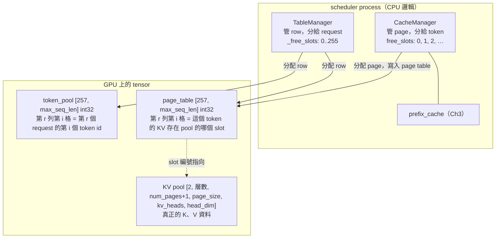
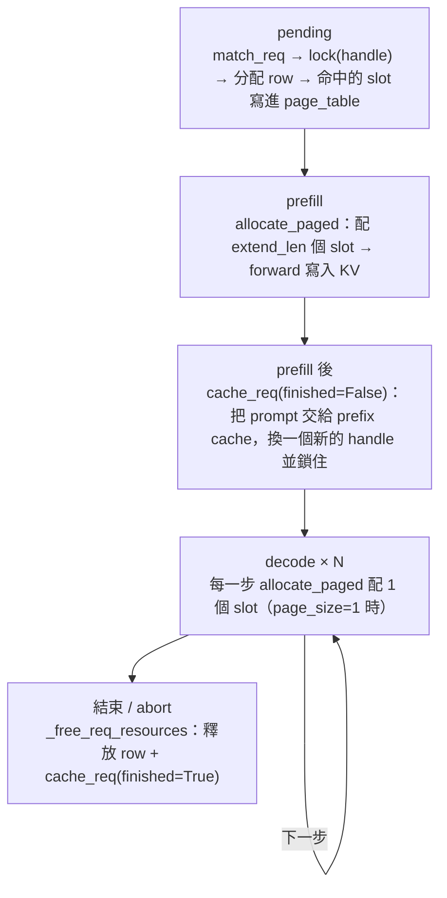

# Ch2 — KV cache 記憶體管理：pool、page table、allocator

> **用法**：大約 75 到 90 分鐘。§1–§2 講**概念**，§3–§8 對照原始碼。**§6 是本章核心**：用一個兩個 request 的例子，把每個 tensor 的實際數值算一遍。這一節請拿紙筆跟著算，考題會考同樣的東西。
> 讀完做最下面的考題。
> 程式碼連結都指向 upstream `9a91cfa`，本地路徑是 `~/Desktop/repos/mini-sglang/python/minisgl/`。

Ch0 算過：Qwen3-0.6B 每個 token 的 KV 佔 **112 KiB**，4 GiB 只放得下大約 37K 個 token。Ch1 看過：scheduler 每一步都可能**加入新 request、移除生成完的 request**。這一章要回答：

> 這一塊有限的 GPU 記憶體，要怎麼分給一群**隨時進出、長度事先未知**的 request？

這一章的程式碼（`CacheManager`、`TableManager`、`PrefillAdder`）正好也是你週日「L1 Rust 化」題目要搬到 Rust 的部分。讀的時候可以順便想想：這些東西有哪些是 CPU 邏輯，哪些必須留在 GPU 上。

---

## 1. 問題：為什麼不能每個 request 開一塊連續記憶體

最直覺的做法：request 進來時，配一塊連續空間 `[max_seq_len, ...]` 給它放 KV。這個做法有三個問題：

1. **長度事先未知**：只能照最壞情況（`max_seq_len`，例如 40K）來配。結果大部分 request 只用到幾百個 token，剩下的空間全部浪費掉。這叫 **internal fragmentation**（配出去了但沒用到）。
2. **進進出出之後，空間變得零碎**：request 長短不一、結束時間各不相同，釋放之後記憶體會變成東一塊、西一塊。總空間明明夠，卻找不到一塊夠大的**連續**空間。這叫 **external fragmentation**。
3. **沒辦法共用**：兩個 request 的開頭一模一樣（例如同一段 system prompt），各自配一塊就只能各存一份。

vLLM 的 **PagedAttention** 論文（2023）借用了作業系統的 **virtual memory paging** 來解決這些問題：

| 作業系統 | KV cache 管理 |
|---|---|
| 實體記憶體被切成固定大小的 page | KV pool 被切成固定大小的 page（每個 page 放 `page_size` 個 token 的 KV） |
| 每個 process 有自己的 page table：虛擬位址 → 實體 page | 每個 request 有一列 page table：**第幾個 token → 存在 pool 的哪個位置** |
| process 看到的位址是連續的，實際上散落各處 | request 的 token 是 0、1、2…連續編號，KV 實際上散落在 pool 各處 |
| 多個 process 可以把同一個實體 page 映射進來（shared memory） | 多個 request 的 page table 可以指向同一段 KV（**prefix sharing**，Ch3） |

這樣一來：
- 需要多少才配多少，一次一個 page → internal fragmentation 最多只有一個 page 減 1 個 token
- 任何一個空的 page 都能用，不需要連續 → **沒有** external fragmentation
- 指向同一段 KV 就是共用 → prefix cache 才有可能實現

代價是：attention kernel 不能再假設「這個 request 的 K 是一段連續的記憶體」，而是要**透過 page table 間接讀取**。FlashInfer、FlashAttention 這類 kernel 都支援這種 paged 讀取方式。

---

## 2. mini-sglang 的整體結構

啟動時**一次把 KV 要用的 GPU 記憶體全部配好**，之後不再向 PyTorch 要記憶體，只在自己的 pool 裡面分配和回收。



四個名詞先定義清楚，本章會一直用到：

| 名詞 | 意思 | 誰管 |
|---|---|---|
| **row**（`table_idx`） | page_table 和 token_pool 裡的一列，一個執行中的 request 佔一列 | `TableManager` |
| **slot** | KV pool 裡放**一個 token**（所有層、所有 KV head）的位置，用整數編號 | — |
| **page** | 連續 `page_size` 個 slot，是**分配的最小單位** | `CacheManager` |
| **handle** | prefix cache 回傳的「你命中了哪一段」的憑證，要 lock 住才不會被 evict | prefix cache（Ch3） |

預設 `page_size = 1`，這時 page 和 slot 是同一件事。§5 會再說明 `page_size > 1` 的情況。

---

## 3. KV pool：真正放 K、V 的地方

### 3.1 形狀

[`mha_pool.py:28-32`](https://github.com/sgl-project/mini-sglang/blob/9a91cfa/python/minisgl/kvcache/mha_pool.py#L28-L32)：

```python
self._kv_buffer = torch.empty(
    (2, num_layers, num_pages, page_size, local_kv_heads, head_dim), ...)
```

- 第 0 維：K 或 V
- 第 1 維：第幾層，所以 `k_cache(layer_id)` 就是 `_k_buffer[layer_id]`
- `num_pages × page_size` 合起來就是 slot 編號。[`:37`](https://github.com/sgl-project/mini-sglang/blob/9a91cfa/python/minisgl/kvcache/mha_pool.py#L37) 的 `_storage_shape` 把它攤平成 `(num_pages*page_size, kv_heads, head_dim)`，所以寫入時只需要一個整數「slot 編號」
- `local_kv_heads`：TP 時每張卡只存自己負責的 KV head。Qwen3 有 8 個 KV head，`--tp 2` 時每張卡存 4 個

**注意**：這是**一整塊** tensor。每層、K 和 V 都在同一塊，全部在啟動時就配好了。

### 3.2 要配多大？

[`engine.py:148-168`](https://github.com/sgl-project/mini-sglang/blob/9a91cfa/python/minisgl/engine/engine.py#L148-L168) `_determine_num_pages`：

```
cache_per_page = 2 × head_dim × local_kv_heads × page_size × dtype 大小 × 層數   ← 就是 Ch0 §7 的公式
model_memory    = 載入權重前的可用記憶體 − 載入後的可用記憶體
available       = 0.9 × 載入權重前的可用記憶體 − model_memory
num_pages       = available // cache_per_page
```

以你的 RTX 3050 為例，**假設**載入前有 7.5 GB 可用，Qwen3-0.6B 的權重大約 1.2 GB：
`0.9 × 7.5 − 1.2 ≈ 5.55 GB`，再除以 112 KiB，大約是 **5 萬個 token**。所有同時執行的 request，加上 prefix cache 存著的東西，全部都要擠在這 5 萬個 slot 裡。

`memory_ratio = 0.9` 留下 10% 給 activation、CUDA graph、sampling 等等其他用途。

### 3.3 多出來的那一個 dummy page

[`engine.py:57-63`](https://github.com/sgl-project/mini-sglang/blob/9a91cfa/python/minisgl/engine/engine.py#L57-L63) 實際配的是 `num_pages + 1`，多一個 **dummy page**。[`:89-98`](https://github.com/sgl-project/mini-sglang/blob/9a91cfa/python/minisgl/engine/engine.py#L89-L98) 建立一個 `dummy_req`，佔用 page table 的最後一列（第 `max_running_req` 列），而且這一列**全部填成 dummy page 的位置**。

這是給 CUDA graph 用的（Ch5）：CUDA graph 只能重播固定 batch size 的計算，例如 batch 實際只有 3 個 request，但錄好的 graph 是 4，就要塞一個 dummy request 進去湊數（[`graph.py:160-166`](https://github.com/sgl-project/mini-sglang/blob/9a91cfa/python/minisgl/engine/graph.py#L160-L166) `pad_batch`）。dummy request 也會真的算、真的寫 KV，所以要有一個「寫了也沒關係」的垃圾桶位置。

### 3.4 寫入：`store_kv`

[`mha_pool.py:45-56`](https://github.com/sgl-project/mini-sglang/blob/9a91cfa/python/minisgl/kvcache/mha_pool.py#L45-L56)：

```python
store_cache(k_cache=..., v_cache=..., indices=out_loc, k=k, v=v)
```

`k` 的形狀是 `[本批的 token 數, kv_heads, head_dim]`（Ch0 的 ragged batch），`out_loc` 是**同樣長度**的整數陣列：第 j 個 token 的 K、V 要寫到 slot `out_loc[j]`。這是一個 scatter 操作，由 [`kernel/store.py:30-42`](https://github.com/sgl-project/mini-sglang/blob/9a91cfa/python/minisgl/kernel/store.py#L30-L42) 的自訂 CUDA kernel 執行。

在每一層 attention 中，順序是**先寫入、再計算**（Ch0 已經看過 [`fi.py:185-188`](https://github.com/sgl-project/mini-sglang/blob/9a91cfa/python/minisgl/attention/fi.py#L185-L188)）。新 token 的 K、V 先寫進 pool，attention kernel 再透過 page table 把**舊的加上新的**一起讀出來。

**KV pool 自己完全不知道 request 是什麼**，它只認得 slot 編號。「哪個 slot 屬於誰」記錄在 page table 裡。

---

## 4. Page table、token pool 與 `TableManager`

### 4.1 兩張同形狀的表

[`engine.py:65-73`](https://github.com/sgl-project/mini-sglang/blob/9a91cfa/python/minisgl/engine/engine.py#L65-L73)：

```python
# NOTE: 1. aligned to 128 bytes; 2. store raw locations instead of pages
self.page_table = torch.zeros((max_running_req + 1, aligned_max_seq_len), dtype=torch.int32, ...)
```

[`table.py:11`](https://github.com/sgl-project/mini-sglang/blob/9a91cfa/python/minisgl/scheduler/table.py#L11)：

```python
self.token_pool = torch.zeros_like(page_table, dtype=torch.int32)
```

| 表 | `[r, i]` 存的是 | 用途 |
|---|---|---|
| `token_pool` | 第 r 列 request 第 i 個位置的 **token id** | forward 時從這裡取出這一步的 `input_ids`；sample 完把新 token 寫回來 |
| `page_table` | 第 r 列 request 第 i 個位置的 **KV slot 編號** | 告訴 kernel 要寫到哪、要從哪讀 |

兩張表都放在 **GPU** 上，這樣 forward 時取 index 不需要經過 CPU。

大小：`257 × 40960 × 4 B ≈ 42 MB`（假設 `max_seq_len` 是 40960），跟 KV pool 的幾 GB 比起來很小。

**注意那行註解的第 2 點：「store raw locations instead of pages」**。vLLM 的 block table 存的是「第幾個 page」，kernel 再自己算 page 內的偏移。mini-sglang 的 page table 則是**每個 token 一格，直接存 slot 編號**。好處是 kernel 端完全不用管 page，所以 [`fi.py:220`](https://github.com/sgl-project/mini-sglang/blob/9a91cfa/python/minisgl/attention/fi.py#L220) 傳給 FlashInfer 的永遠是 `page_size=1`，**不論**系統設定的 `page_size` 是多少。`page_size` 只影響「分配的單位」，不影響 kernel 怎麼讀。

### 4.2 `TableManager`：只是一個 row 的 free list

[`table.py:4-21`](https://github.com/sgl-project/mini-sglang/blob/9a91cfa/python/minisgl/scheduler/table.py#L4-L21)，全部只有 20 行：

- `_free_slots = list(range(max_running_req))`：一個 Python list，存還沒被佔用的 row 編號（注意這裡的 slot 指的是 **row**，名字有點容易混淆）
- `allocate()` 就是 `pop()`，`free(row)` 就是 `append(row)`
- `available_size == 0` 代表已經有 `max_running_req`（預設 256）個 request 在跑，新的 request 必須等

所以 **`max_running_req` 是並行 request 數的硬上限**，跟記憶體夠不夠無關。

---

## 5. `CacheManager`：slot 的分配器

[`cache.py:15-25`](https://github.com/sgl-project/mini-sglang/blob/9a91cfa/python/minisgl/scheduler/cache.py#L15-L25)：

```python
self.free_slots = torch.arange(num_pages, dtype=torch.int32, device=device) * page_size
```

`free_slots` 存的是**每個空 page 的第一個 slot 編號**。`page_size = 2` 時就是 `[0, 2, 4, 6, ...]`。注意它是一個 **GPU tensor**（`device = page_table.device`），分配和回收都是用 `torch.cat`、切片完成的。

### 5.1 分配：`_allocate` 與 `_page_to_token`

[`cache.py:106-113`](https://github.com/sgl-project/mini-sglang/blob/9a91cfa/python/minisgl/scheduler/cache.py#L106-L113)：

```python
if needed_pages > len(self.free_slots):
    evicted = self.prefix_cache.evict((needed_pages - free_pages) * self.page_size)   # 不夠就向 prefix cache 要
    self.free_slots = torch.cat([self.free_slots, evicted[:: self.page_size]])
allocated = self.free_slots[:needed_pages]      # 從前面拿
self.free_slots = self.free_slots[needed_pages:]
```

- 從 `free_slots` **前面**拿，回收的放到**後面**（[`_free`](https://github.com/sgl-project/mini-sglang/blob/9a91cfa/python/minisgl/scheduler/cache.py#L115-L117)）。系統跑一陣子之後，slot 編號就會變得亂七八糟，但這沒有關係，因為有 page table。
- 空間不夠時會先 **evict prefix cache** 裡沒人在用的東西（Ch3）。這就是為什麼 [`available_size`](https://github.com/sgl-project/mini-sglang/blob/9a91cfa/python/minisgl/scheduler/cache.py#L32-L34) = **free 的 + prefix cache 裡可以 evict 的**。

[`_page_to_token`](https://github.com/sgl-project/mini-sglang/blob/9a91cfa/python/minisgl/scheduler/cache.py#L119-L124) 把 page 展開成 slot：`page_size = 4` 時，`[8, 20]` 會展開成 `[8, 9, 10, 11, 20, 21, 22, 23]`。

### 5.2 `allocate_paged`：這一步每個 request 需要幾個新 page

[`cache.py:42-53`](https://github.com/sgl-project/mini-sglang/blob/9a91cfa/python/minisgl/scheduler/cache.py#L42-L53)：

```python
first_page = div_ceil(req.cached_len, page_size)   # 已經有 KV 的部分佔了幾個 page
last_page  = div_ceil(req.device_len, page_size)   # 這一步結束後總共要幾個 page
if last_page > first_page: 需要 last_page − first_page 個新 page
```

回想 Ch1 §6：這一步要處理的 token 是位置 `[cached_len, device_len)`，也就是 `extend_len` 個。

**`page_size = 1`**：每一步剛好配 `extend_len` 個 slot。prefill 配 prompt 長度減 cached 的數量，decode 每一步配 1 個。

**`page_size = 4`**，prompt 6 個 token、沒有 cache：

| 步驟 | cached_len | device_len | first_page | last_page | 新配的 page |
|---|---|---|---|---|---|
| prefill | 0 | 6 | 0 | 2 | 2（8 個 slot，用掉 6 個） |
| decode 1 | 6 | 7 | 2 | 2 | 0（位置 6 落在第 2 個 page 裡，已經配過了） |
| decode 2 | 7 | 8 | 2 | 2 | 0 |
| decode 3 | 8 | 9 | 2 | 3 | 1 |

page 用不完的部分就是 internal fragmentation：每個 request **最多浪費 `page_size − 1` 個 slot**。

配好之後，[`_write_page_table`](https://github.com/sgl-project/mini-sglang/blob/9a91cfa/python/minisgl/scheduler/cache.py#L127-L146) 把 slot 編號寫進 `page_table[row, first_page*ps : last_page*ps]`。它先在 CPU 的 pinned memory 上組好 `(row, 位置)` 兩個 index 陣列，`non_blocking` 搬到 GPU，再用一次 advanced indexing 寫入。CPU 端組 index、GPU 端一次寫完，這個模式在 scheduler 裡到處都是。

### 5.3 那為什麼還需要 `page_size > 1`？

既然 kernel 永遠只看 slot，`page_size = 1` 又完全沒有浪費，為什麼還要支援更大的 page？

- **某些 kernel 規定一定要**：[`engine.py:227-229`](https://github.com/sgl-project/mini-sglang/blob/9a91cfa/python/minisgl/engine/engine.py#L227-L229)，TRT-LLM 的 attention backend 只接受 16、32、64，不符合時會被強制改成 64
- **管理的成本**：`free_slots` 的長度、radix tree 的 key 比對（Ch3），都會隨 page 數變少而變便宜
- **代價**：internal fragmentation，而且 prefix cache 只能以「整個 page」為單位命中（[`radix_cache.py:137`](https://github.com/sgl-project/mini-sglang/blob/9a91cfa/python/minisgl/kvcache/radix_cache.py#L137) 的 `align_down`）

### 5.4 `lazy_free_region`

[`cache.py:93-104`](https://github.com/sgl-project/mini-sglang/blob/9a91cfa/python/minisgl/scheduler/cache.py#L93-L104)：在這個 context 裡呼叫 `_free` 不會立刻 `torch.cat`，而是先收集起來，離開時一次 cat。[`scheduler.py:146`](https://github.com/sgl-project/mini-sglang/blob/9a91cfa/python/minisgl/scheduler/scheduler.py#L146) 在處理上一批結果時用它包住整個迴圈：一批裡可能有好幾個 request 同時結束，這樣就把 N 次 GPU tensor 的 cat 合併成一次。

---

## 6. 一個 batch 怎麼把這些串起來（本章核心）

[`scheduler.py:204-217`](https://github.com/sgl-project/mini-sglang/blob/9a91cfa/python/minisgl/scheduler/scheduler.py#L204-L217) `_prepare_batch` 和 [`:227-233`](https://github.com/sgl-project/mini-sglang/blob/9a91cfa/python/minisgl/scheduler/scheduler.py#L227-L233) `_forward`：

```python
def _prepare_batch(self, batch):
    self.engine.graph_runner.pad_batch(batch)            # ① 湊 batch size（dummy req）
    self.cache_manager.allocate_paged(batch.reqs)        # ② 配新 slot、寫 page_table
    batch.positions = _make_positions(batch, ...)        # ③ 每個 token 的位置（給 RoPE）
    input_mapping = _make_input_tuple(batch, ...)        # ④ (row, 位置)，每個 token 一組
    write_mapping = _make_write_tuple(batch, ...)        # ⑤ 新 token 要寫回 token_pool 的哪裡
    batch.out_loc = self.engine.page_table[input_mapping]  # ⑥ 每個 token 的 KV 寫到哪個 slot
    self.engine.attn_backend.prepare_metadata(batch)     # ⑦ 告訴 kernel 每個 request 要讀哪些 slot

def _forward(self, forward_input):
    batch.input_ids = self.token_pool[input_mapping]     # ⑧ 取出這一步要算的 token id
    forward_output = self.engine.forward_batch(batch, sample_args)   # ⑨ 跑模型 + complete_one
    self.token_pool[output_mapping] = forward_output.next_tokens_gpu # ⑩ 新 token 寫回 token_pool
```

### 例子

`page_size = 1`，`free_slots = [0, 1, 2, 3, 4, 5, 6, 7, ...]`。

- **Request A**：uid 1，分到 row 0，prompt 是 4 個 token `[a0 a1 a2 a3]`，沒有命中 cache
- **Request B**：uid 2，分到 row 1，prompt 是 3 個 token `[b0 b1 b2]`，**前 2 個命中 prefix cache**，那兩個 token 的 KV 在 slot 20、21

**在 prefill 之前**（[`prefill.py:56-61`](https://github.com/sgl-project/mini-sglang/blob/9a91cfa/python/minisgl/scheduler/prefill.py#L56-L61) 和 [`:79-81`](https://github.com/sgl-project/mini-sglang/blob/9a91cfa/python/minisgl/scheduler/prefill.py#L79-L81)）：
- B 的命中部分已經先寫進 page table：`page_table[1, 0:2] = [20, 21]`
- prompt 的 token id 已經寫進 token pool：`token_pool[0, 0:4] = [a0 a1 a2 a3]`、`token_pool[1, 0:3] = [b0 b1 b2]`

| | cached_len | device_len | extend_len |
|---|---|---|---|
| A | 0 | 4 | 4 |
| B | 2 | 3 | 1 |

#### Prefill 這一步

**② `allocate_paged`**：A 要 4 個、B 要 1 個，共 5 個，從 `free_slots` 前面拿 `[0, 1, 2, 3, 4]`。
```
page_table[0, 0:4] = [0, 1, 2, 3]
page_table[1, 2:3] = [4]           → row 1 現在是 [20, 21, 4]
free_slots = [5, 6, 7, ...]
```

**③ positions**：每個 request 的 `arange(cached_len, device_len)` 接起來 → `[0, 1, 2, 3, 2]`
（B 只算第 2 個位置，RoPE 要用真正的位置 2，不是 0。回想 Ch0：K 是加了 RoPE 之後才存的）

**④ input_mapping**：`rows = [0, 0, 0, 0, 1]`，`positions = [0, 1, 2, 3, 2]`

**⑥ out_loc** = `page_table[rows, positions]` = `[0, 1, 2, 3, 4]` ← 這 5 個 token 的 K、V 要寫到這 5 個 slot

**⑦ attention metadata**（[`fi.py:190-225`](https://github.com/sgl-project/mini-sglang/blob/9a91cfa/python/minisgl/attention/fi.py#L190-L225)）：
```
indices      = cat(page_table[0, :4], page_table[1, :3]) = [0, 1, 2, 3, 20, 21, 4]
cu_seqlens_q = [0, 4, 5]     ← Q（這一步算的 token）：A 佔 [0,4)，B 佔 [4,5)
cu_seqlens_k = [0, 4, 7]     ← K（要讀的全部 token）：A 讀 indices[0:4]，B 讀 indices[4:7]
```
B 的那一個 Q 會去看 slot 20、21（從 cache 來）和 4（剛寫進去的），**完全不需要重算 b0、b1**。這就是 prefix cache 省下來的計算。

**⑧ input_ids** = `token_pool[rows, positions]` = `[a0 a1 a2 a3 b2]`

**⑤ ⑩ 寫回新 token**：[`_make_write_tuple`](https://github.com/sgl-project/mini-sglang/blob/9a91cfa/python/minisgl/scheduler/scheduler.py#L262-L267) 在 forward **之前**算好：`rows = [0, 1]`、`positions = [device_len] = [4, 3]`。sample 出來的 A 第一個 token 寫到 `token_pool[0, 4]`，B 的寫到 `token_pool[1, 3]`。

**⑨ 之後**，`complete_one`（[`engine.py:199-200`](https://github.com/sgl-project/mini-sglang/blob/9a91cfa/python/minisgl/engine/engine.py#L199-L200)）：A 變成 cached 4 / device 5，B 變成 cached 3 / device 4。

#### Decode 這一步

| | cached_len | device_len | extend_len |
|---|---|---|---|
| A | 4 | 5 | 1 |
| B | 3 | 4 | 1 |

- **②**：A 位置 4 → slot 5，B 位置 3 → slot 6
- **③ positions** = `[4, 3]`
- **⑥ out_loc** = `[5, 6]`
- **⑦ indices** = `[0, 1, 2, 3, 5,  20, 21, 4, 6]`，`cu_seqlens_k = [0, 5, 9]`
- **⑧ input_ids** = `token_pool[[0,1], [4,3]]` = 上一步 sample 出來、在 ⑩ 寫進去的那兩個 token

這就是 Ch1 說的「上一步的輸出是下一步的輸入」在記憶體層面的實際樣子：**token id 在 GPU 上的 `token_pool` 裡傳遞，不需要繞回 CPU**。這也是 Ch4 overlap scheduling 能成立的前提。

#### 兩個細節

- **ChunkedReq 的 `-1`**：`_make_write_tuple` 對 `can_decode == False` 的 request 寫的位置是 `-1`，也就是最後一格。prefill 只做了一半的 chunked request，sample 出來的 token 是沒有意義的，就丟到最後一格當垃圾。
- **最後一個 token 沒有 KV**：request 生成完的那一刻，最後 sample 出來的 token 只寫進了 `token_pool`，從來沒有被當成 input 跑過 forward，所以 pool 裡沒有它的 KV。考題會用到這點。

---

## 7. Admission control：資源夠才讓 request 進來

[`prefill.py:39-63`](https://github.com/sgl-project/mini-sglang/blob/9a91cfa/python/minisgl/scheduler/prefill.py#L39-L63) `_try_allocate_one`，這是 pending request 要進入 prefill 前的關卡：

```python
if self.table_manager.available_size == 0: return None                 # ① 沒有空的 row
handle = self.cache_manager.match_req(req).cuda_handle                  # ② 查 prefix cache
extend_len = req.input_len - cached_len
estimated_len = extend_len + req.output_len                             # ③ 最壞情況要多少 slot
if estimated_len + self.reserved_size > self.cache_manager.available_size: return None
self.cache_manager.lock(handle)                                         # ④ 鎖住命中的部分
if estimated_len + self.reserved_size > self.cache_manager.available_size:
    return self.cache_manager.unlock(handle)                            # ⑤ 鎖完再檢查一次
table_idx = self.table_manager.allocate()
```

### ② 為什麼查的是 `input_ids[: input_len - 1]`？

[`cache.py:27-30`](https://github.com/sgl-project/mini-sglang/blob/9a91cfa/python/minisgl/scheduler/cache.py#L27-L30) 故意少查最後一個 token。考題會問為什麼。

### ③ 照最壞情況預留

`output_len` 就是 `max_tokens`，預設 1024（[`core.py:20`](https://github.com/sgl-project/mini-sglang/blob/9a91cfa/python/minisgl/core.py#L20)）。也就是說，一個 request 進來時，就要確認**它就算一路生成到 `max_tokens` 也放得下**。

`reserved_size` 一開始是 [`decode_manager.inflight_tokens`](https://github.com/sgl-project/mini-sglang/blob/9a91cfa/python/minisgl/scheduler/decode.py#L27-L30)：所有正在 decode 的 request 還**可能**用到的量（`remain_len` 的總和，加上每個 request 多留 `page_size − 1` 個 slot 給沒湊滿的 page）。同一批每多收一個 request，[`_add_one_req`](https://github.com/sgl-project/mini-sglang/blob/9a91cfa/python/minisgl/scheduler/prefill.py#L77) 就把它的需求加到 `reserved_size` 上。

**結果**：只要被收進來，就**保證**不會在 decode 到一半時發現記憶體不夠。所以 mini-sglang **完全沒有 preemption（搶占）機制**。

這是一個重要的設計取捨：

| | 保守預留（mini-sglang） | 樂觀分配 + 搶占（vLLM、SGLang 正式版） |
|---|---|---|
| 收 request 的依據 | 最壞情況（`max_tokens`）放得下 | 現在放得下就收 |
| 記憶體不夠時 | 不會發生 | 把某些 request 踢出去（丟掉 KV 之後重算，或 swap 到 CPU），之後再回來 |
| 優點 | 簡單，沒有重算的浪費 | 並行數高，記憶體利用率高 |
| 缺點 | `max_tokens` 設很大但實際很短時，大量預留空間沒用到，並行數被壓低 | 搶占有成本，邏輯複雜 |

### ④⑤ 為什麼要鎖完再檢查一次？

lock 之前，命中的那段 KV 如果沒人在用，算在 prefix cache 的 **evictable** 裡，也就是被算進了 `available_size`。lock 之後它變成 **protected**，就不再算進 `available_size`（[`radix_cache.py:113-130`](https://github.com/sgl-project/mini-sglang/blob/9a91cfa/python/minisgl/kvcache/radix_cache.py#L113-L130)）。考題會請你用數字走一遍。

---

## 8. 一個 request 的 KV 一生

把 Ch1 的旅程換成「記憶體」的角度再走一次：



### `cache_req`：交給 prefix cache，而不是直接 free

[`cache.py:55-79`](https://github.com/sgl-project/mini-sglang/blob/9a91cfa/python/minisgl/scheduler/cache.py#L55-L79)，上面那段大註解列出了好幾個區段。目前先抓住重點就好，細節留到 Ch3：

1. 把這個 request `[0, cached_len)` 的 token 和它們的 slot 插入 prefix cache
2. prefix cache 回答「其中前面 `cached_len'` 個**本來就有了**」（可能是別的 request 在這段期間插入的）。這段重複的 slot 就**釋放**，因為 cache 裡已經有一份
3. 解鎖舊的 handle
4. 如果已經結束，插不進 cache 的尾巴（`page_size > 1` 時沒湊滿一個 page 的部分）就釋放；如果還沒結束，鎖住新的 handle

**用 `--cache naive` 時**，[`naive_cache.py`](https://github.com/sgl-project/mini-sglang/blob/9a91cfa/python/minisgl/kvcache/naive_cache.py) 的 `insert_prefix` 什麼都不存，回傳長度 0。所以 request 結束時，它所有的 slot 都會被釋放。這就是實驗 1 要比較的對照組。

**用 radix cache 時**，request 結束後，它的 KV（包含生成出來的回答！）會**留在 GPU 上**，變成 evictable，直到有人需要空間才被 evict。所以多輪對話的下一輪，可以直接命中上一輪的整段內容。

### 不變式：`check_integrity`

[`cache.py:81-91`](https://github.com/sgl-project/mini-sglang/blob/9a91cfa/python/minisgl/scheduler/cache.py#L81-L91)：

```
free 的 page 數 + prefix cache 裡的 page 數 == num_pages
```

它只在 scheduler **閒置**時才被呼叫（[`scheduler.py:78-81`](https://github.com/sgl-project/mini-sglang/blob/9a91cfa/python/minisgl/scheduler/scheduler.py#L78-L81)）。為什麼只在閒置時才成立？因為有 request 在跑的時候，還有一些 slot 既不是 free、也不在 cache 裡（例如 decode 中新生成的部分）。閒置時所有 request 都結束了，每個 slot 一定是這兩種之一。如果不成立，代表有 slot **洩漏**了。

> 💡 **給週日的你**：如果要把 `CacheManager` 搬到 Rust，這條不變式就是最好的 property test。另外注意 `free_slots` 現在是 **GPU tensor**，每次分配都是 GPU 上的切片和 cat。搬到 Rust 時，free list 很自然會放在 CPU 端，只把算好的 index 送上 GPU。這是設計上的一個分歧點。

---

## 9. 讀完你應該能說清楚

- [ ] PagedAttention 解決了哪三個問題？用作業系統的 virtual memory 怎麼類比？
- [ ] KV pool 的形狀每一維是什麼？`num_pages` 怎麼算出來的？為什麼要多一個 dummy page？
- [ ] page table 存的是什麼？為什麼 mini-sglang 存的是 slot 而不是 page 編號？這對 kernel 有什麼影響？
- [ ] row、slot、page 分別由誰管理？
- [ ] 給定一個 batch，能算出 positions、out_loc、indices、cu_seqlens
- [ ] 新 token 怎麼從這一步的輸出變成下一步的輸入（`token_pool`）
- [ ] admission control 的條件；為什麼 mini-sglang 不需要 preemption；代價是什麼
- [ ] request 結束時，它的 KV 去了哪裡（naive 和 radix 各是如何）

---

## 面試題

1. **「解釋 PagedAttention。它解決了什麼問題？有什麼代價？」**
   要點：用作業系統 paging 的概念，把 KV cache 切成固定大小的 page，透過 page table 間接定址。解決了 internal fragmentation（不用照最壞情況配）、external fragmentation（不需要連續空間），並讓 prefix sharing 成為可能。代價是 kernel 要透過間接定址讀取，以及 page 內最後一段的少量浪費。
2. **「一張 24 GB 的卡跑某個 8B 模型，最多可以同時服務多少使用者？」**
   要點：先算每個 token 的 KV 大小（2 × 層數 × kv_heads × head_dim × dtype 大小），用（可用記憶體 − 權重 − 預留）除以它，得到 token 總量，再除以每個 request 的平均（或最壞）長度。同時要說明 GQA 的影響，以及「預留策略」會決定實際上是用平均還是最壞情況來算。
3. **「page size 怎麼選？大和小各有什麼影響？」**
   要點：小 page 的浪費少，prefix cache 命中的粒度也細；大 page 的管理成本低（free list、page table、radix tree key），有些 kernel 規定一定要大 page，而且記憶體存取比較連續。
4. **「KV cache 滿了怎麼辦？」**
   要點：兩種流派。保守預留（admission control 時就照 `max_tokens` 預留，不會滿，但並行數低），或樂觀分配加搶占（recompute 或 swap 到 CPU）。另外可以先 evict prefix cache 裡沒人在用的部分。
5. **「為什麼 serving 引擎啟動時要把 KV 記憶體一次配好，而不是需要時再向 PyTorch 要？」**
   要點：避免 PyTorch caching allocator 在長時間執行後產生碎片、避免執行中 OOM、讓容量可以預測（admission control 才算得準）、CUDA graph 需要固定的位址。

---

## 考題（請在對話中作答）

**Q2.1 — KV pool 的大小**
Qwen3-0.6B（28 層、8 個 KV head、head_dim 128、bf16），`page_size = 1`，`num_pages = 50,000`。
(a) `_kv_buffer` 的完整形狀是什麼（6 個維度都寫出來）？大約佔多少 GB？
(b) 改成 `--tp 2`，**每張卡**的 `_kv_buffer` 形狀哪一維會變？在每張卡可用記憶體相同的情況下，`num_pages` 大約會變成多少？為什麼？

**Q2.2 — page_size = 4 的分配追蹤**
`page_size = 4`，一個 request 的 prompt 有 6 個 token，沒有命中 cache，`max_tokens = 5`。
(a) 它總共跑幾次 forward？每一次 forward 前，`allocate_paged` 各配了幾個新 page？
(b) 結束時，它總共佔了幾個 slot？其中幾個 slot 真的存了 KV？最後一個生成的 token 有沒有 KV？為什麼？

**Q2.3 — 算出一個 decode batch 的 index**
`page_size = 1`。一個 decode batch 依序有兩個 request：
- **X**：row 2，`cached_len = 3`，`device_len = 4`，`page_table[2, :3] = [40, 41, 7]`
- **Y**：row 0，`cached_len = 2`，`device_len = 3`，`page_table[0, :2] = [12, 13]`

這一步之前 `free_slots = [8, 9, 30, ...]`。請寫出：`allocate_paged` 之後兩列 page table 的內容、`positions`、`out_loc`、attention 的 `indices` 和 `cu_seqlens_k`、`input_ids` 是從 `token_pool` 的哪兩格取出來的、sample 出的兩個新 token 會寫進 `token_pool` 的哪兩格。

**Q2.4 — Admission control（`page_size = 1`）**
目前 `free_slots` 剩 1,000 個，prefix cache 裡可以 evict 的有 500 個，正在 decode 的 request 的 `inflight_tokens` 總和是 300。新來一個 request：prompt 900 個 token，其中前 400 個命中 prefix cache，而且**這 400 個目前沒人在用**（算在 evictable 的 500 裡面）。
(a) `max_tokens = 200` 時，第一次檢查和 lock 之後的第二次檢查分別是多少比多少？會被收進來嗎？
(b) `max_tokens = 400` 時呢？
(c) 如果把第二次檢查刪掉，(b) 的情況可能會發生什麼事？

**Q2.5 — 為什麼少查一個 token**
`match_req` 查的是 `input_ids[: input_len - 1]`，而不是整個 prompt。如果同一個 prompt 送了兩次，而且查的是整個 prompt，第二次會發生什麼問題？（提示：想想 `extend_len` 和 Ch1 Q1.4 的 lm_head）

**Q2.6 — 預測題：保守預留的代價**
你的 3050 上 KV pool 大約有 50,000 個 slot。客戶端每個 request 的 prompt 大約 500 token，都**沒有設定** `max_tokens`（所以是預設 1024），但實際上平均只回答 100 個 token 就遇到 EOS。
(a) 理論上記憶體夠放幾個這樣的 request 同時跑？mini-sglang 實際上最多會讓幾個同時跑？
(b) 如果客戶端改成設 `max_tokens = 200`，會有什麼變化？
(c) 如果要讓 mini-sglang 在不改客戶端的情況下提高並行數，你會怎麼改？會引入什麼新問題？（這題沒有標準答案，講出取捨就好）
