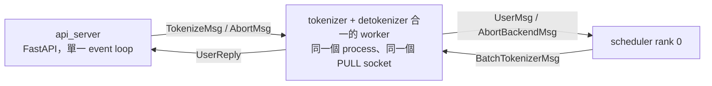
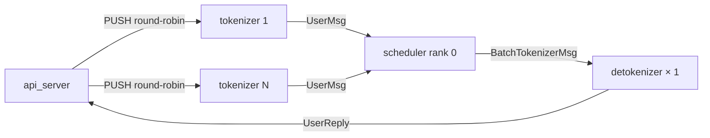
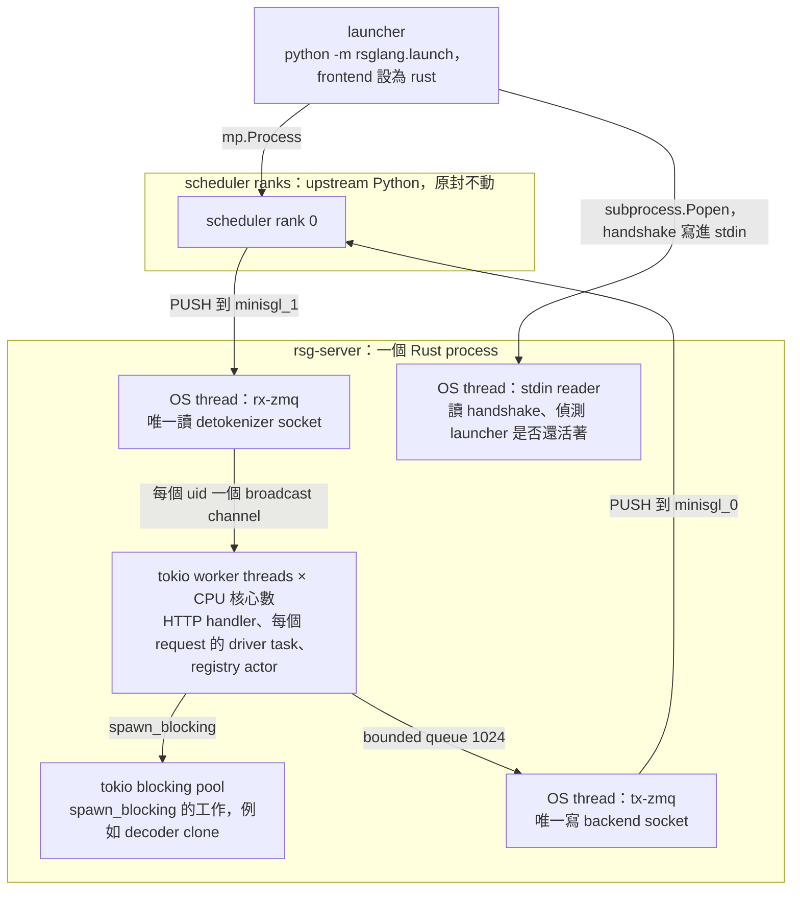
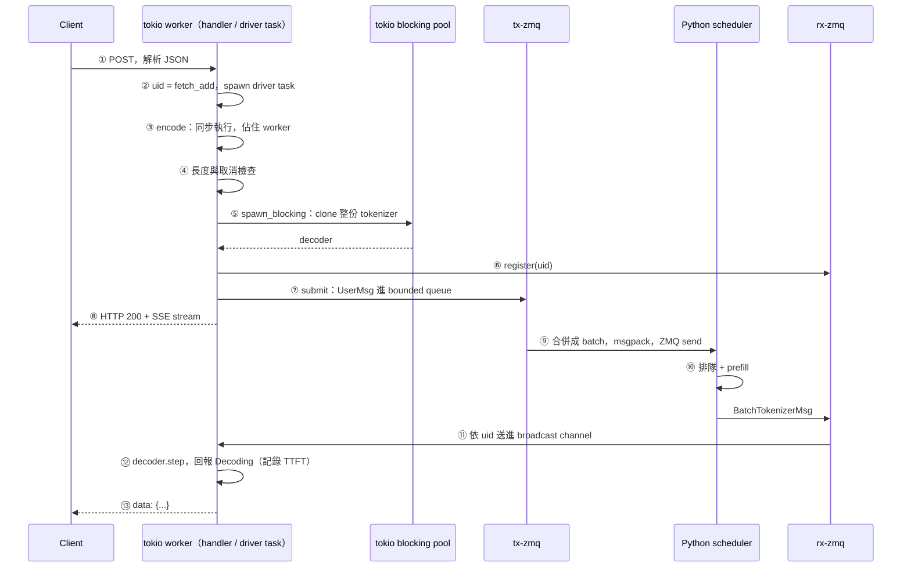
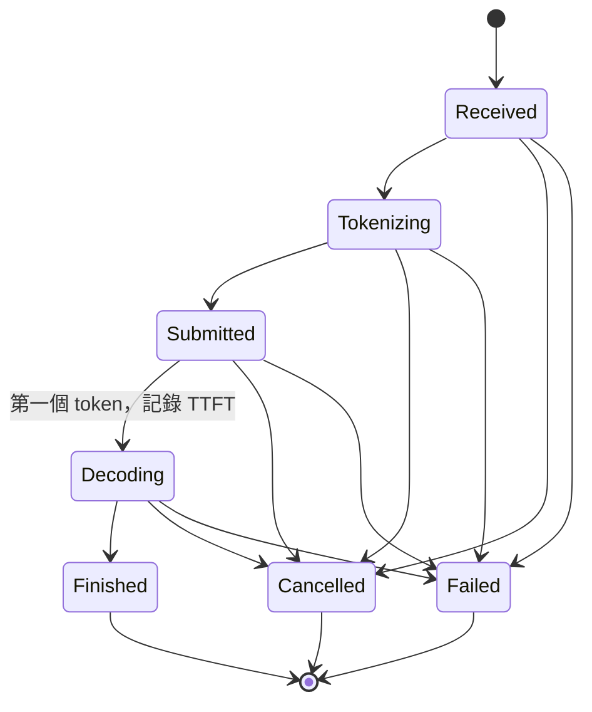

# Ch7 — mini-rsglang：Rust 前端、wire parity 與 P99 之謎（含 Ch6 前端與 IPC）

> **用法**：大約 2 小時，這是你履歷上的專案，所以這章做**完整 quiz**，quiz 本身就是面試模擬。
> - §1–§2：為什麼要改寫前端，以及 upstream 的 Python 前端怎麼運作（原本 Ch6 的內容，壓縮後併進來）
> - §3–§8：mini-rsglang 本身。**§5 是本章核心**：一個 request 在 Rust 前端裡經過哪些 thread、每一站花的時間算在誰頭上
> - §9–§10：怎麼驗證正確性、怎麼量效能，以及 FINDINGS 的結論為什麼站不太住，這也正是 Phase 8 要做的事
>
> mini-rsglang 的連結固定指向 `main` 上的 [`c09b315`](https://github.com/LiyangTseng/mini-rsglang/tree/c09b315)，本地路徑是 `~/Desktop/repos/mini-rsglang/`（Phase 8 的 agent 正在同一份 checkout 上工作，想看原始碼請用 GitHub 連結或 `git show c09b315:<path>`）。
> upstream 的連結指向 `9a91cfa`，本地路徑是 `~/Desktop/repos/mini-sglang/python/minisgl/`。

Ch1 留下一個伏筆：「Rust 前端輸給 Python 前端的是 **P99 TTFT**」。這一章要回答三件事：

1. 只把前端換成 Rust、backend 一行不改，這個專案到底做了什麼，又是怎麼保證「換了之後輸出完全一樣」？
2. 一個 request 在 Rust 前端裡怎麼走？哪些時間是 Rust 獨有、Python 沒有的？
3. FINDINGS 說「P99 爆掉是 ZMQ 的錯」，證據夠不夠？如果不夠，該怎麼量？

---

## 1. 為什麼要改寫前端

### 1.1 Frontend overhead 是什麼

Ch1 的四大元件裡，**Frontend** 負責 HTTP、tokenize、detokenize 和 request 的生命週期，完全不碰 GPU。大部分情況下它不是瓶頸，因為 prefill 和 decode 的時間遠大於前端的處理時間。但有三種情境例外：

| 情境 | 為什麼前端會變成瓶頸 |
|---|---|
| 大量**短** request（例如 32 token 的 prompt） | GPU 每個 request 只花幾 ms，前端的 parse、tokenize、序列化佔比就變大 |
| 大量**取消**（agent 工作流常常中途放棄） | 每次取消都要走一趟 abort 流程，前端要追蹤大量正在建立和拆除的 request |
| **冷啟動**與記憶體 | Python 前端的每個 process 都要 import 一整套 Python 套件，佔幾百 MB 到 GB 的 RAM |

這三種剛好就是 mini-rsglang benchmark 的 S1、S2、S3（§10）。

### 1.2 這是業界真的在做的事

SGLang 官方正在把前端改寫成 Rust（[sgl-project/sglang#23206](https://github.com/sgl-project/sglang/issues/23206)），理由就是 Python 前端在高並發下的 host overhead 和 GIL。mini-rsglang 是這個賭注的**縮小版**：

> 把 backend 完全凍結（`vendor/` 一行不改），只把前端換成 Rust，然後在同一台機器、同一個 backend 上 A/B 比較，**用量測回答「只換前端到底值多少」**。

這個「凍結 backend」的限制很重要，它讓比較變得公平，但也讓某些修法（例如拿掉 ZMQ）不在範圍內。§10 會看到，FINDINGS 的結論就是被這個限制推出來的。

---

## 2. Upstream 的 Python 前端與 IPC（原 Ch6）

Ch1 已經看過 process 架構和訊息名稱。這一節補上 mini-rsglang 必須**一模一樣模仿**的細節，以及 Python 前端自己的效能特性。

### 2.1 Process 與 socket：`--num-tokenizer` 的 0 和 N

[`server/args.py:18-47`](https://github.com/sgl-project/mini-sglang/blob/9a91cfa/python/minisgl/server/args.py#L18-L47)、[`server/launch.py:71-103`](https://github.com/sgl-project/mini-sglang/blob/9a91cfa/python/minisgl/server/launch.py#L71-L103)：

**`--num-tokenizer=0`（預設）**



**`--num-tokenizer=N`（N > 0）**



- `N=0`：tokenize、detokenize、轉送 abort **全部擠在同一個 process、同一個 PULL socket** 上依序處理。encode 一個很長的 prompt 時，所有串流的 detokenize 都要等它
- `N>0`：N 個 tokenizer 加上 1 個 detokenizer。request 怎麼分給 N 個 tokenizer？**mini-sglang 沒有寫任何路由邏輯**，靠的是 ZMQ PUSH socket 預設的 round-robin
- 所以 python-best（`N=2`）的前端有 4 個 process：api_server、2 個 tokenizer、1 個 detokenizer。每個都載入一整套 Python 套件，RSS 就從 1.48 GB 漲到 3.03 GB

> 一個推論（沒有實測）：`N>1` 時，同一個 uid 的 `TokenizeMsg` 和 `AbortMsg` 可能被 round-robin 分到**不同**的 tokenizer，abort 就有機會比 `UserMsg` 先到 scheduler。scheduler 會把它當成未知 uid 忽略，request 則會一路跑完。記住這個情境，§7.3 會看到 Rust 怎麼在結構上杜絕它。

### 2.2 ZMQ 包裝：沒有任何 socket option

[`utils/mp.py`](https://github.com/sgl-project/mini-sglang/blob/9a91cfa/python/minisgl/utils/mp.py) 有六個包裝類別（Push、Pull、Pub、Sub，以及 api_server 專用的 async 版本）：

- `put`：`msgpack.packb(encoder(obj), use_bin_type=True)` 後 `send(copy=False)`（`mp.py:25-26`）
- `bind(addr) if create else connect(addr)`：誰 bind、誰 connect 由 `ServerArgs` 決定
- **完全沒有設定 HWM、LINGER 等 socket option**，全部是 libzmq 的預設值（HWM = 1000 則）。每個包裝各自建立一個 `zmq.Context()`

這一點對 §10 很重要：Rust 前端的 ZMQ 設定（`linger=0`、`reconnect_ivl=1ms`，HWM 用預設）跟 Python 幾乎一樣，兩邊都是 blocking send。

### 2.3 序列化：`__type__` 與 `cls(**kwargs)`

[`message/utils.py:9-69`](https://github.com/sgl-project/mini-sglang/blob/9a91cfa/python/minisgl/message/utils.py#L9-L69)：

- 編碼：先寫 `"__type__": 類別名稱`，再遞迴走過 `self.__dict__`。巢狀的物件（例如 `SamplingParams`）也會變成一個帶 `__type__` 的 dict
- Tensor 必須是 1-D 而且在 CPU 上，編成 `{"__type__": "Tensor", "buffer": tobytes(), "dtype": "torch.int32"}`
- 解碼：用 `__type__` 查出類別，然後 **`cls(**kwargs)`**。dataclass 的 `__init__` 遇到不認得的 keyword 就丟 `TypeError`

| 訊息 | 欄位 | 誰送 → 誰收 |
|---|---|---|
| `TokenizeMsg` | uid, text（字串或 chat list）, sampling_params | api_server → tokenizer |
| `AbortMsg` | uid | api_server → tokenizer |
| `UserMsg` | uid, input_ids（int32 tensor）, sampling_params | tokenizer → scheduler |
| `AbortBackendMsg` | uid | tokenizer → scheduler |
| `BatchBackendMsg` | data | tokenizer → scheduler |
| `DetokenizeMsg` | uid, next_token, finished | scheduler rank 0 → detokenizer |
| `BatchTokenizerMsg` | data | scheduler → detokenizer |
| `UserReply` | uid, incremental_output, finished | detokenizer → api_server |

慣例：**只有一則訊息時一律送「裸」的訊息，不包成只有一個元素的 batch**（[`tokenizer/server.py:83-107`](https://github.com/sgl-project/mini-sglang/blob/9a91cfa/python/minisgl/tokenizer/server.py#L83-L107)、[`scheduler/io.py:124-130`](https://github.com/sgl-project/mini-sglang/blob/9a91cfa/python/minisgl/scheduler/io.py#L124-L130)）。Rust 的 writer 也照做（`writer.rs:154-158`），不然 bytes 就對不上了。

mini-rsglang 只需要模仿 scheduler 邊界上的那 7 種型別（`UserMsg`、`AbortBackendMsg`、`ExitMsg`、`BatchBackendMsg`、`DetokenizeMsg`、`BatchTokenizerMsg`、`SamplingParams`），加上 `Tensor`。`TokenizeMsg`、`UserReply` 這些是 Python 前端**內部**的訊息，Rust 用 channel 取代，不需要模仿。

### 2.4 api_server：一個 event loop 服務所有人

[`server/api_server.py`](https://github.com/sgl-project/mini-sglang/blob/9a91cfa/python/minisgl/server/api_server.py)：

- uid：`new_user()` 用一個從 0 遞增的計數器，同時建立 `ack_map[uid] = []` 和 `event_map[uid] = asyncio.Event()`（`api_server.py:104-114`）
- 背景迴圈 `listen()`（`:116-123`）：await async PULL，拆開 batch，把回覆塞進 `ack_map[uid]`，`set()` 那個 uid 的 event
- `wait_for_ack`（`:134-150`）：等 event、清掉、一次拿走 list 裡的全部回覆。兩次喚醒之間到達的多個回覆會一起處理
- **斷線偵測**（`:190-209`）：只在準備 yield 下一個 chunk 時檢查 `request.is_disconnected()`。斷線時丟 `CancelledError`，`abort_user` 會**先 sleep 0.1 秒**，再送 `AbortMsg`
- 整個 api_server 是**一個** `uvicorn.run(app)`，所有 handler 都在同一個 event loop、同一個 GIL 下執行，JSON 解析（pydantic）也在這裡

小細節：`/generate` 的 SSE 是 `data: {text}\n`，只有**一個**換行（`:154-157`），不是標準 SSE 的兩個。Rust 版也要照抄這個「不標準」，這就是 parity。

### 2.5 Tokenizer worker 與 scheduler 的收發

- tokenizer worker（[`tokenizer/server.py:59-108`](https://github.com/sgl-project/mini-sglang/blob/9a91cfa/python/minisgl/tokenizer/server.py#L59-L108)）：一次處理一則 `TokenizeMsg`（程式碼裡寫著 `# TODO: batch tokenization`）；detokenize 則把整個 running batch 的 token 用 `batch_decode` 一次解完
- detokenize 演算法（[`detokenize.py:54-111`](https://github.com/sgl-project/mini-sglang/blob/9a91cfa/python/minisgl/tokenizer/detokenize.py#L54-L111)）：每個 uid 保存 `DecodeStatus`。每一步把 `ids[surr:]` 和 `ids[surr:read]` 各解碼一次，相減得到新文字。這樣做是為了讓「依賴前文的空白」正確。新文字結尾是 `�`（UTF-8 還沒湊齊）就先不推進 offset，只送出確定可以印的部分
- scheduler 收訊息（[`scheduler/io.py:79-86`](https://github.com/sgl-project/mini-sglang/blob/9a91cfa/python/minisgl/scheduler/io.py#L79-L86)）：**只有在完全沒事做時才 blocking `get()`**；之後一律 `while not empty(): get()`，**把已經排隊的訊息一次拿完**
- scheduler 送訊息：每一步把所有 request 的 `DetokenizeMsg` 包成一個 `BatchTokenizerMsg`

### 2.6 Python 前端自己的效能特性（Phase 2 baseline）

Phase 2 用 py-spy 和 GC hook 量過 Python 前端（[`docs/benchmarks/baseline-profile.md`](https://github.com/LiyangTseng/mini-rsglang/blob/c09b315/docs/benchmarks/baseline-profile.md)）。instrumentation 讓冷啟動慢了約 3.5 倍，所以**只能拿來做歸因，不能當絕對數字**：

- S1 時，api_server 做了 3097 次 GC，總共 1834 ms
- tokenizer process 裡 **detokenize 比 tokenize 重**：S1 佔 40% 對 6%，S2 佔 11% 對 7%。原因是 tokenize 每個 request 只做一次，detokenize 每個 token 都要做
- radix cache 佔 scheduler 時間不到 2%

每個 token 在 Python 前端要經過：dataclass → 遞迴 `__dict__` → msgpack → ZMQ → 解碼 → `UserReply` → 再序列化一次 → ZMQ → api_server 解碼 → 喚醒 event → `json.dumps` → SSE。這些全是純 Python。這就是「Rust 應該會比較快」的直覺來源，也是為什麼 P99 反而變差這麼出人意料。

---

## 3. mini-rsglang 的架構全景

### 3.1 Process 與 thread

用 `python -m rsglang.launch --frontend rust ...` 啟動時（[`launch.py:138-295`](https://github.com/LiyangTseng/mini-rsglang/blob/c09b315/python/rsglang/launch.py#L138-L295)）：



跟 Python 前端對照：

| | Python 前端（`--num-tokenizer=0`） | Rust 前端 |
|---|---|---|
| HTTP | api_server process（FastAPI + uvicorn，單一 event loop） | tokio worker threads（axum） |
| tokenize | tokenizer process | 每個 request 的 driver task，直接在 tokio worker 上執行 |
| detokenize | 同一個 tokenizer process，一個 manager 管所有 uid | 每個 request 的 driver task，**每個 request 有自己的 decoder** |
| 前端 process 數 | 2（`--num-tokenizer=N>0` 時是 N+2） | 1 |
| 平行化手段 | 多 process（繞過 GIL） | 多 thread（沒有 GIL） |

**RSS 從 1.48 GB 降到 490 MB 的原因就在這張表**：Python 每多一個前端 process，就要多載入一份 Python runtime 和 transformers 等套件；Rust 只有一個 process，tokenizer 也只載入一份。

### 3.2 Crate 分工

| Crate／目錄 | 職責 | 對應的 Phase |
|---|---|---|
| [`rsg-wire`](https://github.com/LiyangTseng/mini-rsglang/blob/c09b315/crates/rsg-wire/src/lib.rs) | msgpack 編解碼，跟 upstream byte-for-byte 一致 | 1 |
| [`rsg-tokenizer`](https://github.com/LiyangTseng/mini-rsglang/tree/c09b315/crates/rsg-tokenizer/src) | HF tokenizer 載入、chat template（minijinja）、encode、incremental detokenize | 4 |
| [`rsg-server`](https://github.com/LiyangTseng/mini-rsglang/tree/c09b315/crates/rsg-server/src) | 前端本體：HTTP/SSE、lifecycle、ZMQ transport、writer/dispatcher；另含 `mock-scheduler` binary | 3、5 |
| [`rsg-bench`](https://github.com/LiyangTseng/mini-rsglang/tree/c09b315/crates/rsg-bench/src) | benchmark harness：S1／S2／S3、統計、報表 | 2、7 |
| [`zmq-vs-channel-spike`](https://github.com/LiyangTseng/mini-rsglang/tree/c09b315/crates/zmq-vs-channel-spike) | 一次性的 micro-benchmark，用來支持 FINDINGS 的 ZMQ 假說 | 7 |
| `python/rsglang/` | launcher、handshake、parity 測試（tap／sidecar／sweep）、Phase 2 的 profiling | 1、2、6 |

### 3.3 啟動順序與 handshake

[`main.rs:145-301`](https://github.com/LiyangTseng/mini-rsglang/blob/c09b315/crates/rsg-server/src/main.rs#L145-L301) 的順序值得記住，因為它解釋了冷啟動為什麼比較快：

1. **載入 tokenizer**（`main.rs:171-188`）：跟 backend 載入權重**同時進行**，所以不會拉長端到端的冷啟動時間
2. 開 ZMQ socket，拆成 tx／rx 兩半，分別交給 `tx-zmq` 和 `rx-zmq` thread（`main.rs:198-225`）
3. **HTTP 立刻開始 listen**（`main.rs:230-246`）：`/health` 馬上能回應；生成類 endpoint 在 engine 建好之前會回 `NotReady`（[`http/mod.rs:61-64`](https://github.com/LiyangTseng/mini-rsglang/blob/c09b315/crates/rsg-server/src/http/mod.rs#L61-L64)）
4. **在 stdin 等 handshake**（`main.rs:248-287`）：launcher 等 scheduler 準備好之後，寫一行 JSON 進 rsg-server 的 stdin，內容有 `max_seq_len`、`eos_token_id`、`page_size`、`upstream_sha` 等（[`handshake.rs:1-33`](https://github.com/LiyangTseng/mini-rsglang/blob/c09b315/crates/rsg-server/src/handshake.rs#L1-L33)）。`upstream_sha` 對不上就拒絕啟動（exit 2），避免 wire 格式和 backend 版本不一致
5. 建立 `Engine`，開始服務（`main.rs:289-301`）

另一個小設計：**stdin 收到 EOF 就代表 launcher 死了，rsg-server 立刻退出**（exit 3，`main.rs:303-324`），這樣就不會留下孤兒 process 佔著 port 和 GPU 的 socket。

Socket 的角色：rsg-server 取代的是 Python 的 tokenizer process，所以它對 `minisgl_0`（scheduler bind 的 PULL）做 **PUSH**，對 `minisgl_1`（detokenizer 端點）做 **PULL**。bind 還是 connect 由 CLI 參數決定（[`transport.rs:56-68`](https://github.com/LiyangTseng/mini-rsglang/blob/c09b315/crates/rsg-server/src/transport.rs#L56-L68)），跟 upstream 的 `bind if create else connect` 一致。

---

## 4. Wire contract：為什麼要 byte-for-byte

### 4.1 為什麼「語意相等」不夠

upstream 的 scheduler 解碼時是 `cls(**kwargs)`：msgpack 解出一個 dict，直接當成 dataclass 的 keyword arguments。所以：
- **多一個 key** → `TypeError: unexpected keyword argument` → scheduler 的迴圈直接死掉
- key 改名、型別不對 → 一樣會死，或者更糟，靜悄悄地算錯

backend 是凍結的，不能改成比較寬容的解碼方式。所以 Rust 送出去的每一個 frame，都要跟 Python 自己會送出的 frame **一個 byte 都不差**。byte 相等也是最容易用測試強力驗證的條件：用 Python 產生 golden bytes，Rust 編碼後直接比對 hex。

### 4.2 讓 bytes 相等的四條規則

[`rsg-wire/src/lib.rs:1-21`](https://github.com/LiyangTseng/mini-rsglang/blob/c09b315/crates/rsg-wire/src/lib.rs#L1-L21) 開頭就列出來了：

| 規則 | 為什麼 |
|---|---|
| 用 **named map**（`rmp_serde::to_vec_named`），不用 array | upstream 把 dataclass 轉成 dict |
| struct 欄位順序 = map key 順序，`__type__` 在最前面 | Python dict 保留插入順序，順序不同 bytes 就不同 |
| 浮點數一律 **f64** | Python 的 float 就是 64 bit，msgpack 會編成 float64（`cb` 開頭） |
| tensor 的 buffer 走 `serde_bytes`，編成 msgpack **bin** | 不然會被編成整數陣列，bytes 長度和格式完全不同 |

另外兩個細節：
- **整數用最短的編碼**：127 是 `7f`（1 byte），128 是 `cc 80`，256 是 `cd 01 00`……Python 的 msgpack 和 Rust 的 rmp 都這樣做，測試 [`lib.rs:228-246`](https://github.com/LiyangTseng/mini-rsglang/blob/c09b315/crates/rsg-wire/src/lib.rs#L228-L246) 逐一驗證每個邊界
- `ExitMsg {}` 刻意寫成「有大括號的空 variant」，讓它編成只有一個 entry 的 map `{"__type__": "ExitMsg"}`（`lib.rs:139-140`）

解碼方向則**刻意寬容**：Rust 讀 scheduler 傳回來的訊息時會忽略不認得的 key（`lib.rs:21`）。原則是「送出去的要嚴格，收進來的要寬容」。

### 4.3 讀一個 frame

`AbortBackendMsg { uid: 7 }` 的 bytes（測試 `lib.rs:194, 212-218`）：

```
82                                   ← fixmap，2 個 entry
a8 5f5f747970655f5f                  ← "__type__"（fixstr，長度 8）
af 41626f72744261636b656e644d7367    ← "AbortBackendMsg"（fixstr，長度 15）
a3 756964                            ← "uid"
07                                   ← positive fixint 7
```

考題 Q7.2 會請你寫出另一個 uid 的 bytes。

---

## 5. 一個 request 在 Rust 前端的旅程（本章核心）

以串流的 `POST /v1/chat/completions` 為例。請一站一站點開連結對照著讀，**特別注意每一站跑在哪個 thread 上**。



| 站 | 發生什麼事 | 跑在哪裡 | 程式碼 |
|---|---|---|---|
| ① | axum handler 解析 JSON（解析失敗回 422，**不消耗 uid**），呼叫 `engine.start` | tokio worker | [`http/chat.rs:203-216`](https://github.com/LiyangTseng/mini-rsglang/blob/c09b315/crates/rsg-server/src/http/chat.rs#L203-L216) |
| ② | `Engine::start`：`uid = next_uid.fetch_add(1)`，建立 event channel 和 `AbortGuard`，**spawn 一個 driver task** 專門負責這個 request，然後立刻回傳 | tokio worker | [`engine.rs:220-237`](https://github.com/LiyangTseng/mini-rsglang/blob/c09b315/crates/rsg-server/src/engine.rs#L220-L237) |
| ③ | driver task 回報 `Received`、`Tokenizing`，然後 **encode**（chat template + HF tokenizer），**直接在 tokio worker 上同步執行** | tokio worker | [`engine.rs:356-373`](https://github.com/LiyangTseng/mini-rsglang/blob/c09b315/crates/rsg-server/src/engine.rs#L356-L373) |
| ④ | 檢查 prompt 長度（上限來自 handshake 的 `max_seq_len`，跟 scheduler 自己的丟棄規則一致）；檢查是否已被取消 | tokio worker | [`engine.rs:377-408`](https://github.com/LiyangTseng/mini-rsglang/blob/c09b315/crates/rsg-server/src/engine.rs#L377-L408) |
| ⑤ | **建 decoder：`spawn_blocking` 裡 clone 一整份 `tokenizers::Tokenizer`**（約 15 萬個 vocab，註解自己寫「tens of milliseconds」） | tokio blocking pool | [`engine.rs:410-448`](https://github.com/LiyangTseng/mini-rsglang/blob/c09b315/crates/rsg-server/src/engine.rs#L410-L448)、[`hf_codec.rs:167-175`](https://github.com/LiyangTseng/mini-rsglang/blob/c09b315/crates/rsg-server/src/hf_codec.rs#L167-L175) |
| ⑥ | `dispatch.register(uid)`：送一則 control message 給 `rx-zmq`，登記這個 uid 的路由。**一定要在 submit 之前**，否則回覆可能比路由先到 | tokio worker | [`engine.rs:450-452`](https://github.com/LiyangTseng/mini-rsglang/blob/c09b315/crates/rsg-server/src/engine.rs#L450-L452) |
| ⑦ | `writer.submit(...)`：把 `UserMsg` 放進 writer 的 bounded queue（容量 1024）並 `.await`，拿到 `Submitted` 票根。回報 `Submitted`，送出 `Accepted` | tokio worker | [`engine.rs:454-485`](https://github.com/LiyangTseng/mini-rsglang/blob/c09b315/crates/rsg-server/src/engine.rs#L454-L485)、[`writer.rs:72-87`](https://github.com/LiyangTseng/mini-rsglang/blob/c09b315/crates/rsg-server/src/writer.rs#L72-L87) |
| ⑧ | handler 收到 `Accepted` 才回傳 HTTP response，body 是一個 stream | tokio worker | [`chat.rs:214-229`](https://github.com/LiyangTseng/mini-rsglang/blob/c09b315/crates/rsg-server/src/http/chat.rs#L214-L229) |
| ⑨ | `tx-zmq`：`blocking_recv` 拿到第一則，再用 `try_recv` 把 queue 裡已有的全部拿出來；多則就包成 `BatchBackendMsg`；msgpack 編碼後 **blocking `send`** | `tx-zmq` thread | [`writer.rs:138-167`](https://github.com/LiyangTseng/mini-rsglang/blob/c09b315/crates/rsg-server/src/writer.rs#L138-L167) |
| ⑩ | scheduler（Python）收到、排隊、prefill，產出第一個 token，送 `DetokenizeMsg`（通常是 `BatchTokenizerMsg`） | scheduler process | Ch1 §5 |
| ⑪ | `rx-zmq`：poll（最多等 50 ms）→ 先處理 control（register／deregister）→ 解碼 → 依 uid 送進該 request 的 broadcast channel（容量 256，滿了就**蓋掉最舊的**） | `rx-zmq` thread | [`dispatch.rs:211-254`](https://github.com/LiyangTseng/mini-rsglang/blob/c09b315/crates/rsg-server/src/dispatch.rs#L211-L254)、[`dispatch.rs:316-335`](https://github.com/LiyangTseng/mini-rsglang/blob/c09b315/crates/rsg-server/src/dispatch.rs#L316-L335) |
| ⑫ | driver task 在 `biased select!` 裡收到 token：重設 timeout、第一次就回報 `Decoding`（**registry 在這裡記錄 TTFT**）、`decoder.step` 解碼、送出 `RequestEvent::Token` | tokio worker | [`engine.rs:493-548`](https://github.com/LiyangTseng/mini-rsglang/blob/c09b315/crates/rsg-server/src/engine.rs#L493-L548) |
| ⑬ | response body 的 `stream::unfold` 收到 event，組成 `data: {...}\n\n` 寫給 client | tokio worker | [`chat.rs:229-256`](https://github.com/LiyangTseng/mini-rsglang/blob/c09b315/crates/rsg-server/src/http/chat.rs#L229-L256) |

### 5.1 三個「單一擁有者」的設計

這份程式碼反覆用同一個模式：**一份共享資源只交給一個 thread 或 task 擁有，其他人用 channel 傳訊息給它**，所以熱路徑上沒有 lock。

| 資源 | 唯一擁有者 | 別人怎麼找它 | 換來什麼 |
|---|---|---|---|
| backend PUSH socket | `tx-zmq` | bounded mpsc（1024） | 送出順序 = enqueue 順序，abort 永遠不會插隊到自己的 submit 前面 |
| detok PULL socket 與 uid → channel 路由表 | `rx-zmq` | unbounded mpsc 傳 register／deregister | 路由表不需要 lock |
| request 狀態表 | registry actor（一個 tokio task） | unbounded mpsc 傳 `report` | 狀態轉移是循序的，可以檢查非法轉移 |

ZMQ socket 本來就**不是 thread-safe**，所以「一個 socket 只給一個 thread」不只是設計偏好，而是硬性要求。Python 用 asyncio 的你可以把它想成：每個擁有者都是一個「只消費自己 queue 的 consumer」。

### 5.2 TTFT 拆開來看：哪些是 Rust 獨有的

client 量到的 TTFT 是從送出 HTTP request 到收到第一個 `data:` chunk。把上表攤開：

| 時間花在哪 | Rust | Python | 備註 |
|---|---|---|---|
| HTTP 解析 | ①② | api_server | 兩邊都有 |
| **encode（tokenize）** | ③，**在 tokio worker 上同步執行** | tokenizer process（`--num-tokenizer=N` 時有多個） | Rust 版會**佔住 worker thread**，影響同一個 worker 上的其他 task |
| **decoder clone** | ⑤，每個 request 一次，數十 ms CPU | **沒有**：一個 manager 用 `decode_map` 管所有 uid，共用同一份 tokenizer | **只有 Rust 有** |
| 進 writer queue | ⑦ | ZMQ send | Rust 多了一層 bounded queue |
| ZMQ send | ⑨ | tokenizer process 的 `send` | 兩邊幾乎一樣：blocking send、預設 HWM |
| scheduler 排隊 + prefill | ⑩ | 同一個 backend | 兩邊完全相同 |
| 回程路由 | ⑪ | detokenizer process | 兩邊都有 |
| detokenize + SSE | ⑫⑬ | detokenizer → api_server 多一次 ZMQ | Python 多一跳 |

看完這張表，你應該會產生和 Phase 8 一樣的疑問：**兩邊共有的部分（ZMQ、backend）很難解釋十倍的差距，Rust 獨有的部分（同步 encode、每個 request 一次 tokenizer clone）反而更可疑。** §10 會把這個疑問講完整。

> ⑤ 的註解很有意思：它記錄了兩次修 bug 的歷史。第一次是把 clone 從 submit **之後**移到**之前**（否則 token 會在 decoder 還沒準備好時就開始湧進 channel，把 buffer 灌爆）。第二次是把 clone 包進 `spawn_blocking`（否則同步的 clone 會卡住 tokio worker，餓死其他 request 的 `recv()`）。也就是說，**這個 clone 的成本以前就造成過問題，只是當時修的是「放在哪裡跑」，沒有修「為什麼要 clone」**。

---

## 6. Lifecycle FSM 與 registry actor

### 6.1 七個狀態、十二條合法轉移

[`fsm/state.rs:10-53`](https://github.com/LiyangTseng/mini-rsglang/blob/c09b315/crates/rsg-server/src/fsm/state.rs#L10-L53)：



- 7 × 7 = 49 種 (from, to) 組合裡，**只有 12 種合法**。終止狀態（Finished、Cancelled、Failed）不能再轉移到任何狀態，也不能跳站（例如 `Received → Submitted`）
- `first_token_at` 只在 `Submitted → Decoding` 時設定一次，這就是 server 端的 TTFT
- 測試 [`state.rs:119-156`](https://github.com/LiyangTseng/mini-rsglang/blob/c09b315/crates/rsg-server/src/fsm/state.rs#L119-L156) 把 49 種組合全部列舉一次，確認表格完全正確

### 6.2 Registry actor：用狀態表抓 bug

[`fsm/mod.rs:66-152`](https://github.com/LiyangTseng/mini-rsglang/blob/c09b315/crates/rsg-server/src/fsm/mod.rs#L66-L152)：一個 tokio task 擁有 `uid → ReqState` 的表，所有轉移都透過 `report` 送進來。

它的價值在於**把「資源洩漏」和「重複結束」變成看得見的數字**：
- 每個 request 都必須**剛好一次**走到終止狀態（LIFE-01）。走到終止狀態後就從表上移除
- 所以壓力測試跑完，`active` 應該是 0。不是 0 就代表有 request 卡住了（洩漏）
- `invalid_transitions` 應該也是 0。不是 0 就代表某條程式路徑回報了兩次終止，或者跳了站

`engine.rs` 裡所有離開 driver 的路徑都經過 `finish` 或 `finish_silent`（[`engine.rs:247-269`](https://github.com/LiyangTseng/mini-rsglang/blob/c09b315/crates/rsg-server/src/engine.rs#L247-L269)），就是為了守住「剛好一次」這個不變量。

`report` 會在呼叫當下記錄 `Instant::now()`，所以即使 actor 處理得晚，時間戳也不會失真。TTFT 的 histogram（`rsg_ttft_seconds`）就是在這裡記錄的（`mod.rs:111-116`）。

---

## 7. 取消：最容易出錯的地方

S1 的 benchmark 就是「128 個 agent，大量中途取消」，所以取消路徑的設計直接影響結果。

### 7.1 怎麼知道 client 斷線了：`AbortGuard`

[`engine.rs:92-115`](https://github.com/LiyangTseng/mini-rsglang/blob/c09b315/crates/rsg-server/src/engine.rs#L92-L115)：`AbortGuard` 包著一個 `DropGuard`。**誰擁有 guard，guard 被 drop 時就會觸發 `CancellationToken`**。

- 串流 response：guard 放在 response body 的 stream 裡（`chat.rs:125-132`）。client 斷線 → hyper 丟掉 body → guard 被 drop → token 被取消
- 非串流 response：guard 在 handler 的 future 裡，client 斷線時 future 被 drop，效果一樣

這就是 Rust 的 **RAII**：「東西被丟掉時自動做清理」由型別系統保證，不用記得去呼叫。Python 的對應寫法是 asyncio 在 client 斷線時對 handler 丟 `CancelledError`。

**限制（D-03）**：hyper 只有在**下一次寫入**時才會發現連線斷了。request 還在排隊或 prefill 時，什麼都還沒寫，所以要等到第一個 token 準備好要寫出去，才會發現 client 早就走了。這跟 Ch1 Q1.7 的結論一樣，Python 前端也有同樣的限制（只在 yield 下一個 chunk 時檢查 `is_disconnected()`，而且發現之後還會先 sleep 0.1 秒才送 abort，見 §2.4）。

### 7.2 `biased select!`：取消優先

[`engine.rs:493-500`](https://github.com/LiyangTseng/mini-rsglang/blob/c09b315/crates/rsg-server/src/engine.rs#L493-L500)：迴圈每一圈同時等三件事：取消、backend timeout、下一個 token。`biased;` 讓它**依照寫的順序**檢查，所以取消永遠最先被處理。沒有 `biased` 的話，tokio 會隨機挑一個已就緒的分支，token 一直湧進來時，取消可能被延後好幾圈。

### 7.3 票根：abort 永遠不會插隊

[`writer.rs:25-55`](https://github.com/LiyangTseng/mini-rsglang/blob/c09b315/crates/rsg-server/src/writer.rs#L25-L55) 是整個專案最漂亮的設計之一：

- `Submitted` 的欄位是 private 的，**只有 `submit` 成功 enqueue 之後才能拿到**
- `abort` 必須出示 `Submitted` 票根
- writer 是單一 FIFO、單一 thread

所以「abort 比自己的 submit 先到 scheduler」**在型別層面就不可能發生**。對照 §2.1：Python 前端在 `--num-tokenizer>1` 時，正好可能出現這種插隊，連寫錯的機會都沒有（`writer.rs:42-45` 還有一個 `compile_fail` 測試，證明外部無法偽造票根）。如果 abort 先到，scheduler 會把它當成未知 uid 忽略，接著 submit 到了，request 就會一路跑到 `max_tokens`，白白浪費 GPU。

另外，abort 之前會先 `deregister`（[`engine.rs:271-283`](https://github.com/LiyangTseng/mini-rsglang/blob/c09b315/crates/rsg-server/src/engine.rs#L271-L283)），之後才到的 token 會被 dispatcher 計入 `unknown_uid` 後丟棄。大量取消時這個計數會衝到幾千，所以它只記 debug log，靠計數器觀察（`dispatch.rs:40-54`）。

### 7.4 Immediate 還是 Deferred

[`engine.rs:285-338`](https://github.com/LiyangTseng/mini-rsglang/blob/c09b315/crates/rsg-server/src/engine.rs#L285-L338)：

| 模式 | 取消發生在第一個 token 之前時 |
|---|---|
| `Immediate` | 立刻送 abort |
| `Deferred`（**預設**） | 先等第一個 token（或 timeout）再送 abort |

為什麼預設是比較「慢」的 Deferred？Phase 6 在 GPU 上做 abort 壓力測試時，`Immediate` 模式**讓 upstream 的 scheduler crash 了**，而且找不到能在 scheduler 裡小幅修補的地方（[`main.rs:64-76`](https://github.com/LiyangTseng/mini-rsglang/blob/c09b315/crates/rsg-server/src/main.rs#L64-L76)）。backend 是凍結的，只能繞過去。注意這不是「兩邊同一個設定」：Python 前端沒有這個開關，它在下一次寫 chunk 時才發現斷線，再 sleep 0.1 秒送 abort。parity report 明確指出兩者不是同一個旋鈕，讀 S1 的數字時要記得這個不對稱。

### 7.5 慢 consumer：寧可失敗也不輸出錯的字

每個 uid 的 broadcast channel 容量是 256（[`dispatch.rs:65-68`](https://github.com/LiyangTseng/mini-rsglang/blob/c09b315/crates/rsg-server/src/dispatch.rs#L65-L68)），滿了就蓋掉最舊的 token。driver task 讀的時候會收到 `Lagged(n)`，轉成 `UidEvent::Dropped(n)`，然後**讓整個 request 失敗**（`SlowConsumer`，[`engine.rs:564-578`](https://github.com/LiyangTseng/mini-rsglang/blob/c09b315/crates/rsg-server/src/engine.rs#L564-L578)）。

為什麼不讓 dispatcher 等一下（blocking send）？因為 `rx-zmq` 只有一個 thread，**它一卡住，所有 request 的 token 都會卡住**。犧牲一個慢的 request，比拖垮全部好。為什麼不跳過遺失的 token 繼續輸出？因為 detokenize 是有狀態的（Ch1），少一個 token，後面的文字可能全部是亂碼。

容量從 16 調到 256 的故事也值得一提：CI 的機器只有 2–4 個 vCPU，request task 被排程的時間比 8 核的開發機慢很多，零延遲的 mock backend 在這段空檔裡可以灌進超過 16 個 token（`dispatch.rs:6-15`）。這是「CPU 不夠時，task 排程延遲會放大成功能性錯誤」的實例，跟 P99 問題是同一類現象。

---

## 8. Tokenizer 與 detokenizer 的移植

### 8.1 Encode

[`hf_codec.rs:151-165`](https://github.com/LiyangTseng/mini-rsglang/blob/c09b315/crates/rsg-server/src/hf_codec.rs#L151-L165) 把 `rsg-tokenizer` 接到 `TextCodec` 介面上：
- 純文字（`/generate`）：直接 encode，加上 special tokens
- chat：先用 minijinja 執行模型的 chat template（`add_generation_prompt=true`），再 encode

chat template 是 Jinja 語法，Python 用 `transformers` 的 `apply_chat_template`；Rust 用 minijinja 加上 pycompat 模擬 Python 的字串方法。這是 parity 測試特別要盯的地方。

### 8.2 Detokenize：一行一行從 Python 搬過來

[`rsg-tokenizer/src/detokenize.rs:1-29`](https://github.com/LiyangTseng/mini-rsglang/blob/c09b315/crates/rsg-tokenizer/src/detokenize.rs#L1-L29) 把 upstream 的 `DecodeStatus` 四個 offset 原樣搬過來（`decoded_ids`、`read_offset`、`surr_offset`、`sent_offset`）。

兩個值得記住的決定：
- **不用 `tokenizers` crate 現成的 `DecodeStream`**：它的「不完整 UTF-8」判斷跟 upstream 一樣，但缺了「最後一個 token 是 EOS 時不要輸出」的分支，也缺了 CJK 的 fallback（`find_printable_text`）。少一個分支，輸出就和 Python 不同，parity 就破了
- **`sent_offset` 用「字元數」而不是 byte 數**（`detokenize.rs:26-28`）：Python 的 `len(str)` 算的是字元。中文一個字在 UTF-8 是 3 bytes，用錯單位就會切到字的中間

### 8.3 每個 request 一個 `Detokenizer`

upstream 的 `DetokenizeManager` 是**一個 manager 管所有 uid**，用 `decode_map[uid]` 分開保存狀態，全部共用一份 tokenizer。

Rust 版的 `Detokenizer` 結構一樣（`detokenize.rs:105-125`，內部也有 `decode_map`），但 `HfDecoder` **每個 request 建一個新的**，只用 uid 0（[`hf_codec.rs:178-195`](https://github.com/LiyangTseng/mini-rsglang/blob/c09b315/crates/rsg-server/src/hf_codec.rs#L178-L195)）。而 `Detokenizer::new` 收的是一個 owned 的 `tokenizers::Tokenizer`，所以只能 `clone()` 一份給它。

這個設計讓每個 driver task 可以**自己**做 detokenize，不用集中到某個 thread，代價就是 §5 第 ⑤ 站的 clone。Phase 8 的 Fix A 就是讓所有 decoder 共用同一份 tokenizer（例如 `Arc<Tokenizer>`），保留「每個 task 自己解碼」的好處，拿掉 clone 的成本。

### 8.4 連 JSON 的跳脫都要一樣

串流 chunk 的 JSON 不用 `serde_json`，而是用自己寫的 [`http/pyjson.rs`](https://github.com/LiyangTseng/mini-rsglang/blob/c09b315/crates/rsg-server/src/http/pyjson.rs)，因為 Python 的 `json.dumps` 預設 `ensure_ascii=True`，會把中文跳脫成 `\uXXXX`，`serde_json` 不會（[`chat.rs:6-13`](https://github.com/LiyangTseng/mini-rsglang/blob/c09b315/crates/rsg-server/src/http/chat.rs#L6-L13)）。非串流的回應反而要用 `serde_json`，因為 Starlette 的 `JSONResponse` 是 `ensure_ascii=False`。parity 要求的是 **HTTP 層級**也完全一樣，不只是 token 一樣。

---

## 9. 怎麼證明「換了前端，輸出完全一樣」

驗證分三層，越往下越接近真實環境，成本也越高。

### 9.1 Wire 層：Python 產生 golden bytes（Phase 1）

- [`scripts/gen_wire_fixtures.py`](https://github.com/LiyangTseng/mini-rsglang/blob/c09b315/scripts/gen_wire_fixtures.py) 載入 `vendor/` 裡**真正的** upstream 訊息類別，用 upstream 自己的 `serialize_type` 產生 34 個 `.msgpack` fixture。涵蓋所有 8 種 `__type__`，以及整數寬度的邊界（uid 127／128／255／256……、top_k −32／−33、tensor 長度 63／64……）
- Rust 端的測試（`crates/rsg-wire/tests/fixtures.rs`）不需要 Python：
  - 每個 fixture **解碼後再編碼，bytes 必須完全一樣**
  - 手寫的 Rust 值編碼後必須等於 fixture
- 反方向：Rust 編碼的結果交給 upstream 自己的 decoder 解（`scripts/check_wire_decode.sh`）

### 9.2 Tokenizer 層：語料庫比對（Phase 4）

用 upstream 的 tokenizer 產生 fixture，Rust 逐一比對：
- 16 個精選的 encode 案例（空字串、全是空白、NFD 的 "café"、超長 prompt……）
- 9 種 chat 對話形狀，比對的是**渲染出來的字串**，不只是 token ids
- CJK、emoji（含 ZWJ 組合）、混合文字的真實 token 串流，**一次餵一個 token**，比對每一步吐出的 chunk；以及 `finished` + EOS 的案例
- proptest：餵亂七八糟的 token id，detokenizer 不能 panic

### 9.3 端到端：真實 GPU、同一個 backend（Phase 6）

這一層最有意思的工具是 **tap**（[`python/rsglang/parity/tap.py:1-41`](https://github.com/LiyangTseng/mini-rsglang/blob/c09b315/python/rsglang/parity/tap.py#L1-L41)）：用環境變數開啟的 `meta_path` hook，在 scheduler process **裡面**包住四個方法（收訊息、釋放資源、組 batch、回覆 tokenizer），每次都先記錄、再呼叫原本的方法。這樣就能拿到 backend 視角的「真相」（它實際收到什麼 ids、實際吐出什麼 token），**而且一行 upstream 都沒改**。

有了 tap，`compare.py` 遇到不一致時，可以把錯誤歸到第一個出問題的層：request 錯誤 → tokenization → sampling params → backend → 不完整 → detokenize 或 API。

| 標準 | 內容 | 結果 |
|---|---|---|
| **PAR-01**（硬門檻） | greedy 解碼、一次一個 request、128 個 prompt，**零容忍** | Qwen3：ids 128/128、文字 128/128 |
| PAR-02（參考用） | 並發 128 時的吻合率 | Rust vs Python 32.8%；Python vs 它自己的循序輸出 28.9% |

PAR-02 這麼低不是 bug：並發時 GPU 怎麼組 batch 會改變浮點運算的順序，greedy 的結果就可能不同。**兩邊前端受影響的程度差不多**，這才是重點。這也是為什麼硬門檻要設在「一次一個 request」。

### 9.4 兩個值得在面試講的故事

**Harness 自己的 bug**：早期有一次跑出 `edge-08` 少一個 token，當時歸咎於 GPU 的不確定性。後來發現是 `sweep.py` 把 scheduler 在 `finished=true` **之後**多送的一筆紀錄也算進去了。修法是遇到第一筆 finished 就截斷，並補上回歸測試。教訓：**測試工具本身也要被測試**，「GPU 不確定性」是很方便、但常常錯誤的藉口。

**D-08：abort 打在 prefill 的窗口上**：在真實 GPU 上做取消壓力測試時，`Immediate` 模式讓 scheduler crash（30 次 abort 裡有 1 次落在「已經在跑、還沒吐出第一個 token」的窗口）；`Deferred` 模式則完全健康。用 probe 直接往 backend socket 注入訊息，72 次只在 1 ms 延遲時打中窗口一次。backend 不能改，所以選擇繞過去：把預設值改成 `Deferred`（§7.4）。

### 9.5 rsg-server 自己的整合測試

| 測試 | 證明什麼 |
|---|---|
| [`ordering_proptest.rs`](https://github.com/LiyangTseng/mini-rsglang/blob/c09b315/crates/rsg-server/tests/ordering_proptest.rs) | 透過真實的 transport 和 mock 子程序，abort 永遠不會超過自己的 submit（最多 48 個 uid 的隨機交錯） |
| [`stress_128.rs`](https://github.com/LiyangTseng/mini-rsglang/blob/c09b315/crates/rsg-server/tests/stress_128.rs) | 128 個 agent × 2 個 request、隨機取消：沒有洩漏、沒有失敗，每個 request 剛好一個終止狀態。**只驗正確性，不量效能** |
| `transport_misbehavior_e2e.rs` | abort 之後才到的 token 會被丟掉並計數；batch 回覆依 uid 正確分流；沉默的 uid 不會拖住其他 uid |
| `api_parity.rs` | 回放錄下來的 Python HTTP 回應，body 必須 byte-identical |

**mock scheduler**（[`bin/mock-scheduler.rs`](https://github.com/LiyangTseng/mini-rsglang/blob/c09b315/crates/rsg-server/src/bin/mock-scheduler.rs)）讓這一切能在 Mac 上跑：它講同樣的 wire 協定，token 是 prompt 的回聲（第 k 個 token = `prompt_ids[k % len]`），延遲固定（`--prefill-delay-ms`、`--decode-delay-ms`），還能刻意「行為不良」（abort 後多送 3 個 token、丟掉超長 prompt）。程式碼自己註明它**「never performance evidence」**（`:40-42`），因為它沒有 GPU、沒有真實的排程。Phase 8 的 #14 要在它上面建 loop，正是利用「它不是真的 backend」這一點：如果 P99 尖峰在 mock 上也出現，問題就一定在前端。

---

## 10. Benchmark 結果，以及 FINDINGS 的結論為什麼站不太住

### 10.1 結果

在 RTX 3050 上，每個 arm 跑 5 輪，用 Welch's 95% CI（[FINDINGS.md](https://github.com/LiyangTseng/mini-rsglang/blob/c09b315/docs/benchmarks/FINDINGS.md)）：

| | python-default | python-best | Rust |
|---|---|---|---|
| 冷啟動（端到端） | 9.67 s | 10.74 s | **9.13 s** |
| 前端 RSS | 1.48 GB | 3.03 GB | **490 MB** |
| S1 P50 TTFT | 54.0 ms | 54.2 ms | 75.0 ms |
| **S1 P99 TTFT** | 409 ms | 431 ms | **4687 ms**（+988%，CI [913%, 1063%]） |
| S2 P99 TTFT @ rate=60 | — | 126 ms | **1016 ms** |
| 吞吐量 | 統計上打平（S1 Rust 少約 3%） | | |

注意這個形狀：**P50 只差 20 ms，P99 差了十倍，吞吐量幾乎一樣。** 這代表大部分 request 都很正常，只有少數 request 被卡了好幾秒。§10.3 的每個假說都要能解釋這個形狀。

在 GPU 上實際跑起來的過程中，還找到並修了 4 個真實的 bug（FINDINGS「Action」一節）。其中最值得在面試講的是 `standard_throughput` 的那個：Rust 的 backend watchdog 預設 60 秒沒收到 token 就判定失敗，但在 8 GB 的 GPU 上，這個 workload 連 Python 的 P99 TTFT 都要約 100 **秒**。而且 launcher 根本沒把 `--backend-timeout-ms` 轉傳給 rsg-server。

### 10.2 FINDINGS 的推論（v1 假說）

FINDINGS 的論證是這樣的：
1. 讀了 `engine.rs`、`dispatch.rs`、`writer.rs`，沒看到明顯的 bug
2. 所有 submit 和 abort 都擠過**一個** `tx-zmq` thread、**一個** bounded queue、**一個** ZMQ socket
3. 如果 scheduler 來不及從 PULL socket 拿訊息，PUSH 的 send 就會阻塞，阻塞再往回傳到 bounded queue，卡住後面所有 request 的 `submit().await`
4. 用 [`zmq-vs-channel-spike`](https://github.com/LiyangTseng/mini-rsglang/blob/c09b315/crates/zmq-vs-channel-spike/README.md) 做了一個 micro-benchmark：receiver 刻意每則訊息花 2 ms，sender 全速送。結果 ZMQ 的 p50／p99 幾乎是 0，但 **max 高達 1.5–1.65 秒**，形狀是「平常很快、偶爾災難性地卡住」
5. 這個形狀跟真實 benchmark 一致，SGLang 官方也因為類似原因放棄了 ZMQ
6. 結論：這是「凍結 backend」的誠實代價

### 10.3 為什麼證據不夠

| 論點 | 問題 |
|---|---|
| 1. 沒看到明顯的 bug | 「讀程式碼沒看到」不是證據。而且 §5.2 那張表裡確實有 Rust 獨有的 CPU 工作 |
| 2–3. 單一 thread／queue／socket | Python 前端的 tokenizer process 也是**單一** socket、blocking send、預設 HWM。同樣的結構，Python 卻沒有爆 |
| 4. spike 的形狀 | spike 的條件是人造的：receiver 固定每則 2 ms，sender 無限速。這會讓 ZMQ 的 queue 堆到 HWM（預設 1000）上限，然後 send 卡住，直到 receiver 消化掉一大批。考題 Q7.8 會請你估算：1.5 秒的卡頓大約對應消化多少則訊息？真實的 scheduler 每一圈會**一次把所有待處理的訊息拿完**，queue 真的會堆到 1000 則嗎？ |
| 5. 形狀一致 | 「跟假說一致」不等於「被假說解釋」。其他假說也能產生同樣的形狀 |
| — | `rsg_writer_queue_depth` 這個 gauge 從來沒有跟真實的 run 對照過（FINDINGS 自己列在 Future work）。而且它是 point-in-time 的：只有在 `/metrics` 被 scrape 的那一瞬間才取樣，很容易錯過短暫的尖峰 |

### 10.4 Phase 8：量測，而不是推論

這就是你主導的 Phase 8（[計畫](https://github.com/LiyangTseng/mini-rsglang/blob/feat/phase-8-p99-root-cause/docs/plans/phase-8-p99-root-cause.md)）：

| 假說 | 預測 | 怎麼分辨 |
|---|---|---|
| H1：每個 request 一次 tokenizer clone，128 個並發時把 blocking pool 和 CPU 塞滿，還跟 Python scheduler 搶 CPU | decoder build 的 P99（包含排隊時間）跟著 TTFT 的尾巴走；**在 mock stack 上也會重現** | #15 的 per-stage histogram，#14 的 mock loop |
| H2：encode 在 tokio worker 上同步執行，餓死其他 task | encode 本身不慢，但 task 的排程延遲很大；worker thread 越少越嚴重 | 同上，再改變 worker 數 |
| H3（v1）：ZMQ send 在 HWM 阻塞 | submit 階段的 P99 跟著尾巴走；queue depth 的尖峰和 TTFT 尖峰同時出現；**在 mock stack 上不會重現**（mock scheduler 消化得很快） | 同上，加上 `send_backend` 的阻塞時間 |

步驟是 `diagnosing-bugs` 的紀律：#14 先建立一個秒級、能重現症狀的 loop → #15 加 instrumentation → #16 判定假說 → #17 修 → #18 在 GPU 上跑 before/after，把 FINDINGS 的 v1 分析保留下來，另外加上 v2。

**不管結果是哪個假說，這都是一個好故事**：如果是 H1／H2，你推翻了原本的結論，找到真正的 root cause 並修好；如果是 H3，你把「推論」升級成「量測」，而且確認了修法必須動 backend。面試官想聽的是這個過程。

---

## 11. 讀完你應該能說清楚

- [ ] 為什麼只改寫前端、而且要凍結 backend；這個限制帶來什麼好處和代價
- [ ] Python 前端的 process 架構，`--num-tokenizer` 的 0 和 N 有什麼差別
- [ ] Rust 前端有哪些 thread，各自擁有什麼；為什麼一個 ZMQ socket 只能給一個 thread
- [ ] 為什麼 wire 要 byte-for-byte，四條編碼規則各自防的是什麼
- [ ] 一個 request 經過的 13 站，每一站在哪個 thread 上
- [ ] TTFT 裡哪些部分是 Rust 獨有的
- [ ] FSM 的 7 個狀態和 12 條轉移；registry actor 怎麼抓洩漏
- [ ] `AbortGuard`、`biased select!`、`Submitted` 票根各自解決什麼問題
- [ ] Immediate 和 Deferred 的差別，以及為什麼預設是 Deferred
- [ ] 為什麼 dispatcher 寧可讓慢的 request 失敗，也不要阻塞
- [ ] 怎麼驗證 parity（wire、tokenizer、端到端）
- [ ] S1／S2／S3 各量什麼；FINDINGS 的 v1 推論是什麼，哪裡證據不足；Phase 8 的三個假說各自怎麼分辨

---

## 面試題

1. **「介紹一下 mini-rsglang。」**（30 秒版本）
   要點：把 mini-sglang 的 Python 前端換成 Rust，backend 完全不動，在同一台機器上 A/B。結果：記憶體少 67–84%、冷啟動快 5–15%、吞吐量打平，但 P99 TTFT 變差十倍。我主導的部分是找出 P99 的真正原因：原本的結論是 ZMQ，但那只是推論，我用 per-stage instrumentation 量出……（Phase 8 完成後補上數字）。
2. **「你怎麼保證 Rust 版的輸出跟 Python 版完全一樣？」**
   要點：三層。wire 層用 Python 產生的 golden bytes 比對 hex；tokenizer 層用語料庫比對 encode 和逐 token 的 detokenize 輸出；端到端在真實 GPU 上，用同一個 backend 跑同一組 prompt，greedy 解碼逐字比對。
3. **「為什麼 Rust 前端記憶體少這麼多？」**
   要點：Python 用多 process 繞過 GIL，每個 process 各自載入一份 Python runtime 和套件；Rust 用多 thread，只有一個 process、一份 tokenizer。
4. **「為什麼吞吐量打平，P99 卻差十倍？代表什麼？」**
   要點：吞吐量由 GPU 決定，兩邊共用同一個 backend，所以打平是預期的。P50 只差 20 ms，代表大部分 request 正常；P99 爆掉代表少數 request 被卡住好幾秒，要找的是「偶發的排隊或阻塞」，不是「每個 request 都慢一點」。
5. **「如果 P99 是 ZMQ 造成的，你怎麼證明？」**
   要點：在 submit 階段量 `send` 的阻塞時間，和 TTFT 尖峰做時間對照；在 mock backend 上看能不能重現（mock 消化得很快，ZMQ 應該不會塞住）；同時排除 Rust 獨有的 CPU 工作。
6. **「Rust 的 async 裡什麼東西不能放在 worker thread 上跑？」**
   要點：長時間的同步 CPU 工作和 blocking I/O。它會佔住 worker，同一個 worker 上的其他 task 就無法被 poll。解法是 `spawn_blocking`、專用的 thread pool，或者乾脆不要做那個工作（例如共用 tokenizer，不要每次 clone）。

---

## 考題（完整 quiz，請在對話中作答）

**Q7.1 — Process 與 thread 盤點**
假設 `--tp 1`、機器有 8 核。分別寫出 (a) Python 前端 `--num-tokenizer=0`、(b) `--num-tokenizer=2`、(c) Rust 前端時，**前端**有幾個 process，各自做什麼。Rust 前端除了 tokio 的 worker thread 之外，還有哪些專用的 OS thread？為什麼 python-best 的 RSS（3.03 GB）比 python-default（1.48 GB）高這麼多？

**Q7.2 — 寫出 wire bytes**
仿照 §4.3，寫出 `AbortBackendMsg { uid: 300 }` 的完整 hex。如果有人把 `SamplingParams.top_p` 改成 `f32`，scheduler 那邊會發生什麼事？如果有人在 `UserMsg` 裡多加一個欄位 `priority`，又會發生什麼事？

**Q7.3 — 為什麼 abort 不會插隊**
說明 `Submitted` 票根、單一 FIFO、單一 `tx-zmq` thread 這三者怎麼一起保證「abort 一定在自己的 submit 之後才到 scheduler」。如果改成「abort 走另一個專用的 socket，讓它不用排隊、更快送達」，會發生什麼事？請寫出具體的錯誤情境和後果。

**Q7.4 — FSM 追蹤**
寫出下列每種情況的狀態轉移序列，以及 registry 的哪些計數器會改變：
(a) 正常完成
(b) 收到第 3 個 token 後 client 斷線
(c) prefill 還在進行時 client 斷線（`Deferred` 模式，backend 最後有回應）
(d) prompt 超過 `max_seq_len`
在 (c) 裡，client 斷線後 scheduler 還會繼續工作多久？為什麼？

**Q7.5 — 標出 thread**
一個 request 從送出到收到第一個 token，依序寫出它經過的每個步驟，並標出每一步跑在：tokio worker／tokio blocking pool／`tx-zmq`／`rx-zmq`／scheduler process。哪幾步會**佔住** tokio worker、讓同一個 worker 上的其他 task 無法前進？

**Q7.6 — 估算 decoder clone 的影響**
假設一次 tokenizer clone 要 30 ms 的 CPU 時間，機器有 8 核，S1 的 128 個 agent 幾乎同時送出 request。
(a) 如果 clone 能完美平行化到 8 核，最後一個 request 的 clone 要排隊多久才輪到？
(b) 實際上這 8 核還要分給誰用？（提示：§3.1 的 process 表，以及 scheduler 每一步都需要 CPU 來 launch kernel）
(c) 光靠 (a) 的數字能解釋 4.7 秒的 P99 嗎？如果不能，你還需要什麼「放大機制」？
（這題沒有標準答案，重點是推論過程。）

**Q7.7 — 慢 consumer**
dispatcher 為什麼選擇「蓋掉最舊的 token、讓那個 request 失敗」，而不是「等 consumer 讀完再送」？為什麼 request 收到 `Dropped` 時不能直接跳過、繼續輸出？channel 容量從 16 調到 256，是因為 CI 機器上出現了什麼現象？這個現象跟 P99 問題有什麼共通點？

**Q7.8 — 檢驗 spike 的證據**
spike 的設定是：receiver 每則訊息固定花 2 ms，sender 全速送，結果 ZMQ 的最大卡頓是 1.5–1.65 秒。
(a) 1.5 秒的卡頓，大約等於 receiver 消化了多少則訊息？
(b) libzmq 預設的 send HWM 和 receive HWM 都是 1000。用 (a) 的數字推論：sender 是在什麼條件下卡住、什麼條件下恢復？（這是推論，說出你的推理即可）
(c) 真實的 scheduler 每一圈會一次拿完所有待處理的訊息。S1 的 128 個 agent 有可能讓 queue 堆到 1000 則以上嗎？
(d) 所以這個 spike 證明了什麼、沒證明什麼？要怎麼量才能直接回答？

**Q7.9 — 設計實驗**
Phase 8 的 #14 要在 mock stack（不需要 GPU）上建立 loop。針對 §10.4 的 H1、H2、H3，分別說出：mock 上會不會重現 P99 尖峰？per-stage histogram 會長什麼樣子？如果 mock 上**重現不了**，你會得到什麼結論，下一步要做什麼？

**Q7.10 — Detokenize 的單位**
`DecodeStatus.sent_offset` 為什麼要用字元數而不是 byte 數？舉一個中文的例子，說明用 byte 數會在哪一步出錯、client 會看到什麼。

**Q7.11 — 你的 30 秒 pitch**
用三句話介紹 mini-rsglang：(1) 做了什麼、(2) 量到什麼、(3) 你負責什麼。第 (3) 句先依照 Phase 8 目前的進度寫，Phase 8 完成後再更新。這題會一直追問到你能流暢說出來為止。
