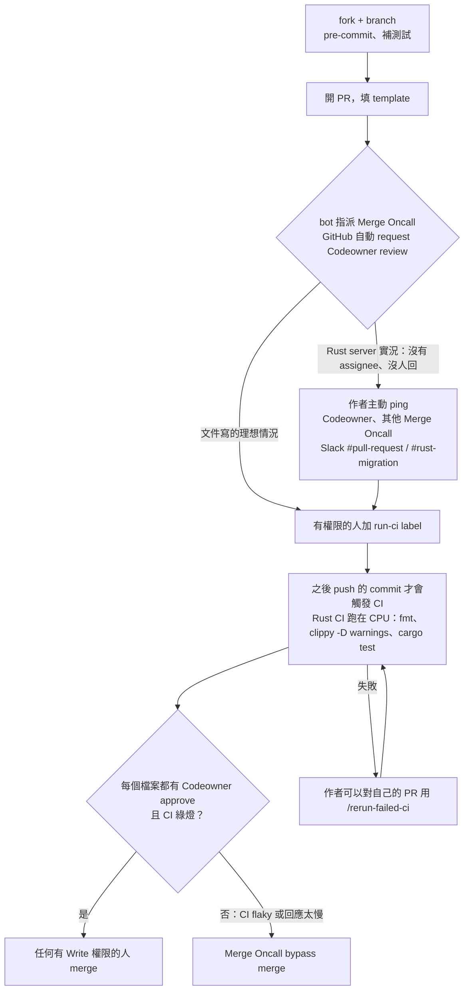
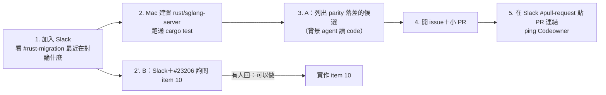

# SGLang contributor 快速入門（10/14）

> 整合三份官方文件（[README § Development and Contributing](https://github.com/sgl-project/sglang#development-and-contributing)、[Contribution Guide](https://docs.sglang.io/docs/developer_guide/contribution_guide)、[MAINTAINER.md](https://github.com/sgl-project/sglang/blob/main/.github/MAINTAINER.md)），加上 10/14 在 GitHub 上實際觀察到的狀況。Rust 候選 issue 的細節見 [2026-10-14-sglang-rust-issues.md](2026-10-14-sglang-rust-issues.md)。

## TL;DR

1. **沒有「認領」制度。** 官方文件完全沒提 issue assign。大型改動「先在 issue 或 Slack 討論」，但沒說要等誰同意。
2. **卡關點是 review 和 CI，不是許可。**
   - PR 要有 `run-ci` label 才會跑 CI，而只有 `CI_PERMISSIONS.json` 裡的 268 人能加，你不在名單上。
   - merge 需要每個改到的檔案都有 Codeowner approve，否則要 Merge Oncall 用 bypass。
3. **`rust/sglang-server` 沒有 Merge Oncall**，只有 Codeowner（@rainj-me、@merrymercy）。官方流程裡「bot 指派 Merge Oncall」在這一塊實際上沒發生，所以社群的 Rust PR 常常沒人接。
4. **真正的入口是 Slack**：[slack.sglang.io](https://slack.sglang.io)，頻道 `#rust-migration`、`#pull-request`。官方明文允許「負責人沒回應就去 ping 其他相關的人」。
5. **第一個 PR 的建議**：小的 parity bug fix，附上重現步驟和 Python 對照測試。同時在 Slack 問 item 10（latency metrics）有沒有人做。

---

## 1. 三份官方文件各說了什麼

| 文件 | 重點 |
|---|---|
| **README** | 從 `lmsysorg/sglang:dev` Docker image 開發，`pip install -e "python"`。流程三步：fork + branch（大改動先在 issue/Slack 討論）→ 改 code、跑測試、**補 regression test**、`pre-commit run --all-files` → 開 PR，寫清楚改了什麼、怎麼測，必要時附 benchmark/accuracy。長期 contributor 可以 email 申請 coding agent 贊助（Cursor、Claude Code、Codex）。 |
| **Contribution Guide** | fork（新人沒有 push 權限）、pre-commit、不要直接 commit 到 main。測試規範：unit test 放 `test/registered/unit/`，目錄結構對應 `python/sglang/srt/`；必須用 `CustomTestCase` 並呼叫 `register_*_ci(...)`。CI 觸發規則和 slash command。code style 規範。新手建議挑 `good first issue`、`help wanted`，並推薦先讀 **Mini-SGLang**（你已經讀完了）。 |
| **MAINTAINER.md** | 四種角色（Merge Oncall、Codeowner、Write、CI Oncall）。PR merge 流程。各模組的 Merge Oncall 名單。CI Maintenance Mode：main 的 CI 壞掉時**禁止 merge 非 CI 修正的 PR**。Rebase-Required Mode。 |

## 2. 角色與 merge 流程

| 角色 | 能做什麼 | 跟你的關係 |
|---|---|---|
| **Merge Oncall** | merge、必要時 bypass branch protection | 主動推動 PR 的人。Rust server 沒有專屬的 Merge Oncall |
| **Codeowner** | approve（每個改到的受保護檔案都需要一個） | `rust/sglang-server` → @rainj-me、@merrymercy |
| **Write** | 在 CI 綠燈且 Codeowner 已 approve 之後才能 merge | 實際按 merge 的常是 @hanming-lu、@ShangmingCai、@Fridge003 |
| **CI Oncall** | 管理 GPU runner | 跟你無關 |



## 3. CI：你能做什麼、不能做什麼

| 指令 | PR 作者（你） | 說明 |
|---|---|---|
| 加 `run-ci` label（`/tag-run-ci-label`、`/tag-and-rerun-ci`） | ❌ | 要請有權限的人幫忙。新 PR 要用 `/tag-and-rerun-ci` 才會跑**當下這個 commit**；只加 label 的話，要等下一次 push 才會跑 |
| `/rerun-failed-ci` | ✅ 只限自己的 PR | 想避免洗版，可以編輯舊的留言、在後面加字（例如 `/rerun-failed-ci try again`） |
| `/rerun-test`、`/rerun-group rust-server` | ❌ | 需要 `cooldown_interval_minutes: 0` 或 write 權限 |
| `/run-full-ci`、`/run-extra-ci` | ❌ | 會加 label，作者的特例不涵蓋 |

- **反應代表的意思：** 👍 表示 handler 收到了；😕 表示指令打錯了；沒有任何反應表示 handler 根本沒看到這則留言。
- **低權限使用者有 cooldown：** 預設 120 分鐘（`pr-gate.yml`）。
- **CI 很貴，有人會搶：** 高優先的 PR 可能把你的 job 擠掉，這時要 rerun。
- **開工前先看 [issue #21065](https://github.com/sgl-project/sglang/issues/21065)：** 它是 open 的話代表在 Maintenance Mode，你的 PR 不會被 merge。body 裡有 `MIN_BASE_SHA:` 的話，代表要先 rebase 到那個 commit 之後，CI 才會跑。

## 4. 官方沒寫、但實際觀察到的狀況

| 觀察 | 證據 |
|---|---|
| 認領通常只是留言，然後直接動手，沒有人等回覆 | #23206 底下 7 位社群成員都是「留言後馬上發 PR」，或留言時就已經附上 PR |
| 社群在 Rust server 的 RFC 項目 PR，**全部沒有 review** | #34224、#34879、#36986、#37202、#37440、#38276、#41462：0 review、沒有 `run-ci`、沒有 assignee，最久的已經掛 2 個月 |
| 合進去的 Rust PR 集中在一小群反覆出現的作者 | 8 月以來的作者：@metamergebot（內部 `oss-sync` 帳號）、@rainj-me、@merrymercy、@sagearc、@sherlockwu、@jain-ria |
| 內部正在快速補齊 parity | 10/13–14 @metamergebot 合了 4 個以上「[Rust] Serve X from the Rust frontend」，包括 `/metrics`（#43942） |
| 被合的 PR 寫得很完整 | #43942 的 body：Motivation、Modifications（逐點列出）、**跟 Python 版的差異**、跑過的測試指令、用 Python 產生的 fixture 鎖定 byte 對等 |
| 社群的 non-Rust bug fix 合得很快 | @Kare0638 5 月的 bug fix #25064 兩天就 merge，docs PR #23801 當天就 merge |
| 還沒看到社群 PR 被內部「吃掉」 | 7 個項目逐一比對，都沒有被內部重做。但照目前的速度，未來撞到的機率不低 |

**結論：** 問題不在於有沒有人同意你做，而在於**有沒有人在意到願意 review**。要提高被 merge 的機率，可以從三方面著手：

- **選題：** 選 maintainer 正在乎的事，也就是 parity 和 bug。
- **PR 寫法：** 讓 reviewer 幾乎不用動腦，小、有測試、寫出跟 Python 的差異。
- **曝光：** 在 Slack 主動讓人看到。

## 5. 開發環境（Rust server 這一塊）

> ⚠️ 以下指令是從文件和其他 PR 整理出來的，**尚未在你的 Mac 上實測**。第一次建置時要驗證。

```bash
gh repo fork sgl-project/sglang --clone
```

```bash
cd sglang/rust && RUSTFLAGS='-C link-arg=-undefined -C link-arg=dynamic_lookup' cargo test -p sglang-server
```

- **macOS 需要額外的 RUSTFLAGS：** PyO3 crate 在 macOS 上 link 時需要上面那段 `RUSTFLAGS`。修正它的 PR #39361 還沒合。
- **CI 跑的檢查，本地先跑過一次：**
  - `cargo +nightly fmt -- --check`
  - `cargo clippy --locked -p sglang-server --all-targets -- -D warnings`（warning 會當成 error）
  - `cargo test --locked -p sglang-server`
- **Python 端：** `pip install -e "python"`、`pre-commit install`、`pre-commit run --all-files`（第一次失敗的話再跑一次）。
- **跑 e2e：** 用 `SGLANG_RUST_SERVER=1` 切到 Rust 前端。已經有人在 Apple Silicon 上用 MLX 跑通（#39935、#39843）。
- **GPU box：** 只在需要 perf 數字時才用。
- **Rust 單元測試的寫法：** 照既有的 mock pattern，`routes().with_state(..).oneshot(..)` 搭配假的 `TextTokenizer`。

## 6. PR 怎麼寫才會被看

**Template 的段落：** Motivation / Modifications / Accuracy Tests / Speed Tests / Checklist。沒有適用的段落就寫「Not applicable」，並說明原因。

**`rust/sglang-server/README.md` 的 code review 原則：**
- 邊界要有明確的型別：production 路徑不能用 `serde_json::Value` 或 `rmpv::Value`。
- 只有一份 canonical schema，跟 `io_struct.py` 對齊。
- 每個 stage 只有一種資料表示方式。
- 驗證和版本控制要明確。

**通用的 code style（Contribution Guide）：**
- 同一段超過 5 行的程式碼重複出現，就抽成 function。
- function 大約不超過 100 行；檔案不超過 2000 行。
- 偏好 pure function，不要 in-place 修改參數。
- 兩個以上的參數用 keyword 傳。
- 新的 data container 用 `msgspec.Struct`。
- **絕對不要用 pickle 反序列化網路上收到的資料。**
- 新功能用 if/else 分支時，既有的 code path 放在第一個分支。

**從 #43942 學到的加分寫法：**
1. Motivation 寫成具體的使用者痛點，例如「Rust 模式下 `GET /metrics` 回 404」。
2. Modifications 逐點列出，每一點都說明**為什麼**這樣設計，例如「merge 在 blocking thread 上跑，避免拿 GIL 卡住 scheduler」。
3. **明確列出跟 Python 版行為不同的地方。**
4. 用 Python 產生 fixture，讓 Rust 輸出跟它 byte-for-byte 比對。這正是你在 mini-rsglang 做 parity 的手法。
5. 列出實際跑過的 cargo 和 pytest 指令。

## 7. 你的第一個 PR：建議路線

| 路線 | 做法 | 被 merge 的機率 | 時間 |
|---|---|---|---|
| **A. Parity bug fix**（主線） | 用 differential testing 比對 Rust 和 Python 前端，找出行為不一致的地方 → 開 issue，附重現步驟 → 發一個小 PR，附 Python 對照測試 | 高：這正是內部現在在合的類型（例如 #44207 的 `extra_key`） | 找 bug 1–2 天，PR 1 天 |
| **B. Item 10 latency metrics**（並行） | 在 Slack `#rust-migration` 和 #23206 留言，tag @merrymercy 和 @hanming-lu，問內部有沒有打算做。有正面回覆才開工 | 中：有人背書就高 | 留言 5 分鐘；實作約 M |
| C. 直接認領 RFC 項目，做完就發 PR | 社群目前的常見做法 | 低：前面那 7 個 PR 都沒有 review | — |

**行動順序：**



**要注意：**
- 跟 @LiyangTseng 對一下 item 28（weight update APIs），避免你們兩人做重疊的東西。
- 你的 tokenizer clone bug 在 SGLang 不存在（`dynamo_tokenizers::Tokenizer` 本來就包在 `Arc` 裡）。不要拿它當切入點，但 P99 分析的經驗可以用在 item 16（perf，@rainj-me 的項目）：以「協助量測」的形式提出，不要去搶。

## 8. 常見地雷

- PR 開在 Maintenance Mode 期間，或 base 早於 `MIN_BASE_SHA`，CI 不會跑。
- 沒跑 pre-commit 就發 PR，`lint` 失敗會把所有 job 擋下來。
- 只加 `run-ci` label 而不 rerun，**當下這個 commit 不會跑**。
- draft PR 放著太久會被 stale bot 關掉（#33211、#32585 都是這樣被關的）。
- 一次改太多。被 merge 的 Rust PR 多半只改一件事，有時還會先拆成 stacked PR，例如 #43942 是疊在 #43924 上面。
- 用 `serde_json::Value` 偷懶，會違反 code review 原則。

## 來源

- 官方文件：[README](https://github.com/sgl-project/sglang#development-and-contributing)、[Contribution Guide](https://docs.sglang.io/docs/developer_guide/contribution_guide)（原始檔 `docs/docs/developer_guide/contribution_guide.mdx`）、[MAINTAINER.md](https://github.com/sgl-project/sglang/blob/main/.github/MAINTAINER.md)、`.github/CODEOWNERS`、`.github/CI_PERMISSIONS.json`
- 觀察：#23206 的所有留言、上面列出的 PR 狀態（10/14 用 `gh` 查詢）、8 月以來 merge 的 Rust PR 作者統計
